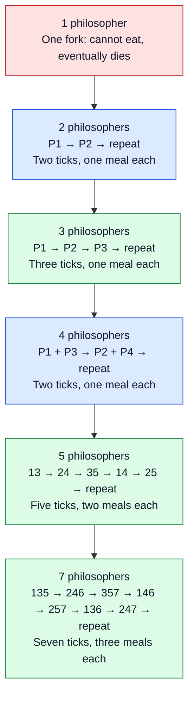
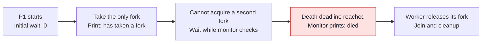
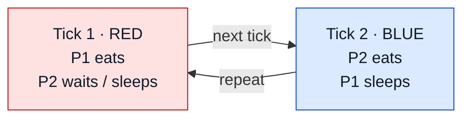
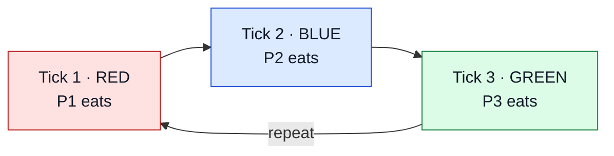
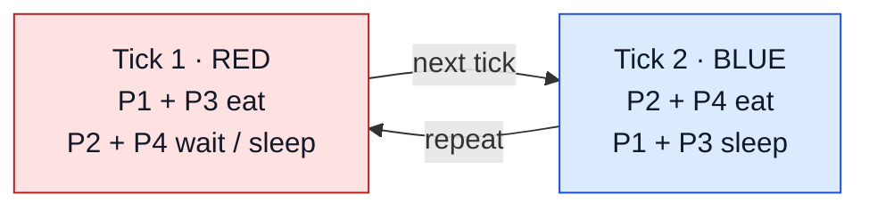
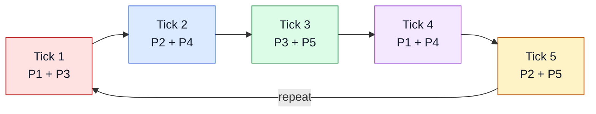
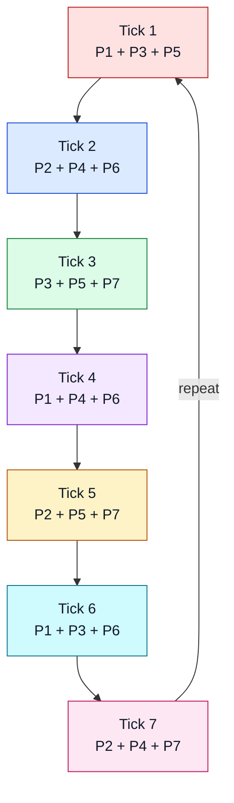
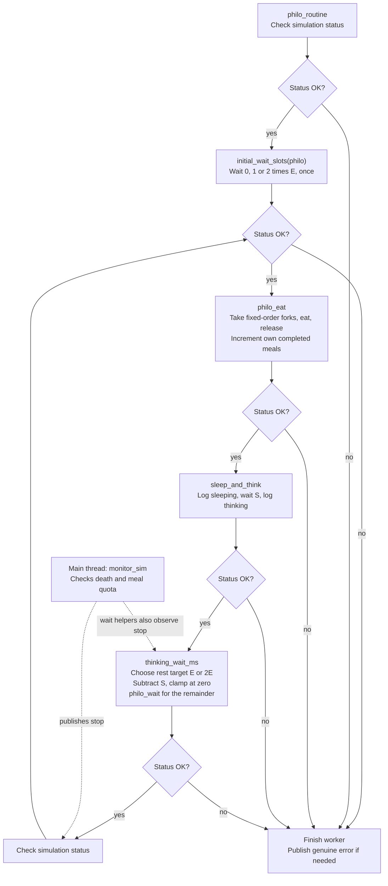

*This project has been created as part of the 42 curriculum by hnah.*

Want pictures? [See the step-by-step clock diagrams](#learning-point-34)
or jump straight to [the code-flow diagram](#clock-code).
These diagrams and their walkthrough are **AI-generated** from my ideas and
code; feel free to skip them if that is not your thing lol.

```text
42 FELINES: THE FELI-O-SO-FURRR PROJECT
                                                          --:
                                                        -*+++=+
                                                      -=*==*+*.
                                                     +-   =+=
                                                 .:-++-----:
                                             .:--=+=:             ......:::::::.....
                                     .+===+=-::--:            :=------:::::::::-------=:
                        .=:         :#: :=%@*+*+-:::::::::::::=*+*+--::::::::::::--+*+*=::
                 ..     %=+#:      .%.  #+-::-:::-:::::::::::::::--------------------:::::
                =*===-:=%=-++++:   #:  *@
                =+-*-:-:  .  .@#+.*=  :#*=:-::::::::---:::-::--:----:::::::::::::::--:::::
                 %.+:    =@*  +=.@+   #- :::=%:::%=:::::::::::::::::::::::::::::::::::::::
                 -*     . ::  :=*+   :#     -*   #.
                  %. .--==    .+=    %.     =+   #
    :-=--.        =*  .--    -+:    #-      +=  .#
   +*. .-*-        -+=      .:    .#-       *=  :#
   -+-=   %.        *+.          :#:        #-  -*
      *+  %.     :=+-           -#.         #:  =+
     .#. +*    =+=.             %.          #.  *=
    .%: -#   =*-               +*           #   #:
    #- .%. .#=                -#           .%   #.
   =*  #- .#:         =.     +%            .#   #
   *-  %  #-          .#.  .**#            :#  .#
   ++  #- %            %  =*: #.           -*  :#
    #-  ++#          :#=-+*+  =*           =*  -*
    .++: ..        :=*+*#  #=  ===         ++  =+
      .-===+-::::::-:.==@-  *=-++#.        =*--*-
            :-----------.    ....           ....
```

THE FELI-O-SO-FURR IS STEALING THE FORK!

One hungry philosopher just lost their chance to eat.

Summary of my philosopher project and the 1 problem I tried to solve for weeks: A hungry (odd-id) cat.

# Philosophers

## Contents

1. [Description](#description) — [see how the clock works](#see-how-it-works)
2. [Instructions](#instructions)
3. [Resources](#resources)
4. [Appendix: my learning points](#appendix-my-learning-points)

## Description

A C project about threads, mutexes, and the dining philosophers problem.
The mandatory program will model philosophers eating, sleeping, and thinking,
while protecting shared forks and monitoring starvation.

The mandatory implementation is complete: argument parsing, resource
initialization, the eating/sleeping/thinking cycle, monitoring, meal quotas,
and cleanup. The [final validation report](debug/eval_logs_2026-10-24_final/SUMMARY.md)
records the passing checks and their timing/coverage limits.
The mandatory sources, header, and Makefile are in `philo/`, as required by
subject version 13.0. Libft is not used.

This README is long because I learned way more than I expected from Philo lol.
The project description, build instructions, and resources come first; the
thread, pointer, mutex, and time rabbit holes are in the linked learning
appendix below.

Shoutout to [**FORKNITE**](https://github.com/CrispyNuggetD/42sg-campus-lan/tree/main/minigames/forknite),
the browser game in my [LAN42](https://github.com/CrispyNuggetD/42sg-campus-lan)
that became my de facto Philo visualiser lol. It runs my actual compiled
`philo` executable and turns its output into something I can watch and replay.
The philosophers are eating and dying according to this C program; I just gave
the terminal logs a browser and an unnecessarily dramatic name.

In LAN42, `/game forknite` creates a room, friends use `/join ROOM_NUMBER`,
and the host uses `/start`. My local setup points to this project's executable,
so rebuilding Philo updates what the game runs. Browser pause/replay only affects
the visualisation, not the running C simulation.

There is also a publicly available
[Philosophers visualiser by rom98759](https://rom98759.github.io/Philosophers-visualizer/)
for viewing eating, sleeping and thinking activity as a chart.

<a id="see-how-it-works"></a>

### See how it works: my clock idea

**AI-generated diagrams and walkthrough, based on my design and code.**
The pictures show the intended rhythm with equal eating/sleeping durations
and ideal handoffs. My local waits encourage this rhythm; actual thread
scheduling and fork contention can shift it. One tick below means one
`time_to_eat`, and the listed IDs are the philosophers eating together.



The arrows between counts are a learning progression, not one simulation
changing its number of philosophers. `13` means P1 and P3 together.
The clock expands from alternating individuals to rotating groups.

[Walk through the coloured diagrams, waits, and matching code step by step](#learning-point-34).

## Instructions

Build from this folder with `make`, or use `make -C philo`.
The compiler uses `cc -Wall -Wextra -Werror -pthread`.
The executable is `philo/philo`.

`make clean` removes object files and `make fclean` also removes executables
from both `philo/` and `philo_bonus/`. `make re` rebuilds mandatory.

`make bonus` builds the bonus scaffold. Bonus is still WIP: input parsing,
process helpers and semaphore initialization/cleanup are in place, but the
philosopher routine and parent supervision are TODO. Valid input currently
initializes and cleans up resources, reports "not implemented", and exits with
a nonzero status; it does not run the simulation yet.

The command format is:

```sh
./philo/philo number_of_philosophers time_to_die time_to_eat time_to_sleep \
    [number_of_times_each_philosopher_must_eat]
```

The simulation stops when a philosopher dies or everyone completes the
optional meal quota.

## Resources

- Philosophers subject, version 13.0 (provided locally).
- Local manual pages: `man pthread_create`, `man pthread_mutex_init`,
  `man pthread_join`, `man gettimeofday`, and `man usleep`.
- AI assistance helped explain concepts and write these learning notes.
  It also helped with implementation, refactoring, and checks throughout
  the simulation, including initialization, logging, timing, and cleanup.

## Appendix: my learning points

Push_swap taught me to model state with structs, pointers, and arrays.
Pipex introduced processes, `fork()`, pipes, and `waitpid()`. In Philo I am
learning how threads share memory and how to coordinate their access to it.

These notes are separate from the mandatory project description and build
instructions above. Examples may be exercises or plans rather than implemented
simulation features. The numbered links jump to each learning point.

<a id="learning-points"></a>

1. [Threads](#learning-point-1)
2. [Mutexes](#learning-point-2)
3. [Semaphores](#learning-point-3)
4. [Deadlock and starvation](#learning-point-4)
5. [How I plan to build it](#learning-point-5)
6. [Do I need a static variable?](#learning-point-6)
7. [A process contains threads](#learning-point-7)
8. [Concurrency versus parallelism](#learning-point-8)
9. [Creating and joining a thread](#learning-point-9)
10. [Why I call `pthread_create()` for each philosopher](#learning-point-10)
11. [Why the argument is `void *`](#learning-point-11)
12. [Mutex lifecycle and critical sections](#learning-point-12)
13. [Why counter++ needs synchronization](#learning-point-13)
14. [Fork pointers: * versus **](#learning-point-14)
15. [Fork locks versus meal locks](#learning-point-15)
16. [Deadlock is different from starvation](#learning-point-16)
17. [Measuring time and sleeping](#learning-point-17)
18. [How my simulation structs fit together](#learning-point-18)
19. [Reading the manual: mutex initialization can fail](#learning-point-19)
20. [What mutexes do beneath the surface](#learning-point-20)
21. [Exercises before the full simulation](#learning-point-21)
22. [Thread handles are not the threads themselves](#learning-point-22)
23. [Passing a pointer does not give a thread private memory](#learning-point-23)
24. [Copy the mutex pointer, not the mutex object](#learning-point-24)
25. [NULL arguments: defaults, omitted inputs, and ignored outputs](#learning-point-25)
26. [Why I saw volatile in Minishell, but it is not a Philo lock](#learning-point-26)
27. [What atomic means](#learning-point-27)
28. [What the non-default pthread settings actually configure](#learning-point-28)
29. [Recursive mutex use case and the caller-held-lock alternative](#learning-point-29)
30. [Main as monitor versus a separate monitor thread](#learning-point-30)
31. [Why I use separate stop and printing locks](#learning-point-31)
32. [My mathematical rabbit hole: fairness, odd counts, and eating clocks](#learning-point-32)
33. [Removed experiments: what I tried, and why I took it out](#learning-point-33)
34. [See the clock grow: 1, 2, 3, 4, 5, and 7 philosophers (AI-generated diagrams)](#learning-point-34)
35. [What if the sleep is weirdly long? Valid inputs, different clocks](#learning-point-35)
36. [Bonus: why another semaphore just to take two forks?](#learning-point-36)

<a id="learning-point-1"></a>

### 1. Threads

In Pipex, `fork()` created separate processes. Changing an ordinary variable
in the child did not change the parent's copy.

Threads run inside the same process and share its memory. Each thread has
its own stack for local variables and function calls, but if I pass two
threads a pointer to the same struct, both can access it.

| What I used in Pipex | What I will use in mandatory Philo |
| --- | --- |
| `fork()` to create a process | `pthread_create()` to create a thread |
| Separate memory spaces | Shared memory inside one process |
| Pipes for communication | Pointers to shared structs |
| `waitpid()` to wait for children | `pthread_join()` to wait for threads |

Each philosopher gets their own thread and repeats:

```text
take two forks -> eat -> release forks -> sleep -> think -> repeat
```

The OS decides when threads run. I cannot assume philosopher 1 runs before
philosopher 2 just because I created them in that order.

[Back to appendix index](#learning-points)

<a id="learning-point-2"></a>

### 2. Mutexes

A mutex is a lock: one thread can hold it at a time. The name means
"mutual exclusion". For mandatory Philo, each fork has its own mutex.
Locking that mutex means holding the fork; unlocking means putting it down.
If someone already holds it, another thread trying to lock it waits.

Mutexes also protect shared data. A philosopher updates their `last_meal`,
while the monitor reads it. Those accesses need synchronization to avoid
a data race, which the subject forbids.

```text
philosopher: lock -> update last_meal -> unlock
monitor:    lock -> read last_meal   -> unlock
```

Both must use the same mutex. Just putting a mutex in the struct does not
protect anything lol; the accesses actually have to follow the locking rule.

[Back to appendix index](#learning-points)

<a id="learning-point-3"></a>

### 3. Semaphores

A semaphore keeps a count of available resources. For example, a fork pool
could start with a count of 5:

- `sem_wait()` takes one permit and decreases the count. If none are
  available, it waits.
- `sem_post()` returns one permit and increases the count.

A mutex belongs to the thread that locked it, which must unlock it.
A semaphore does not have that same ownership rule.

The bonus uses a separate process per philosopher, so `fork()` comes back.
All forks are in a shared pool represented by a semaphore. Mandatory uses
threads and mutexes; semaphores are not in its allowed function list.

[Back to appendix index](#learning-points)

<a id="learning-point-4"></a>

### 4. Deadlock and starvation

If everyone takes their left fork first, they could all end up holding one
fork and waiting for their neighbour's fork. Nobody can eat or release
their forks. That is deadlock.

One approach is to number the forks and always lock the lower-numbered
fork before the higher-numbered fork. This prevents circular waiting.
It does not guarantee fairness: a philosopher could still keep missing
chances to eat. That is starvation.

One philosopher needs special handling. There is only one fork, so they
can take it but cannot eat. Trying to lock the same mutex twice is not
the solution; they wait until they die.

[Back to appendix index](#learning-points)

<a id="learning-point-5"></a>

### 5. How I plan to build it

Keep the data in structs and pass pointers to the threads:

| Shared simulation data | Each philosopher's data |
| --- | --- |
| Number of philosophers and timing arguments | ID and thread handle |
| Simulation start time | Pointers to their two forks |
| Fork mutex array | Last meal time and meal count |
| Stop flag and its mutex | Mutex protecting meal information |
| Output mutex and philosopher array | Pointer to the shared simulation |

The main thread can monitor the philosophers after creating their threads.
It checks whether `current_time - last_meal >= time_to_die`, and whether
everyone has completed the optional meal quota.

The death timer starts at the **start** of the last meal, not the end.
Before the first meal, it starts at the simulation start. The subject also
requires the death message within 10 ms of the actual death.

Printing needs coordination too: messages must not overlap, and normal
state messages should not slip out after the death message. Protect the
shared stop flag as well as the meal data.

My steps are:

1. Parse and validate arguments.
2. Define and initialize structs and mutexes.
3. Create threads, run a small routine, and join them.
4. Add fork acquisition and the eating, sleeping, thinking cycle.
5. Add protected meal tracking and death monitoring.
6. Add coordinated stopping, sleeps that can respond to stopping, and cleanup.

At the end, join the threads before destroying the mutexes and freeing
the data they use. Also handle partial initialization or thread creation
failures properly.

[Back to appendix index](#learning-points)

<a id="learning-point-6"></a>

### 6. Do I need a static variable?

My friends used one, but no, the subject does not require it.

A `static` variable inside a function keeps its value between calls.
Threads calling that function share that variable; it is not a separate
copy for each thread. Concurrent access can still need a mutex.

A file-scope `static` variable is still a global variable, even though
only that source file can name it. The subject forbids globals.

A `static` function is different: it just makes the function private to
its source file. It does not store shared simulation state.

I can keep things like the start time and stop flag in the simulation
struct instead. That makes it easier to see what is shared and which
mutex protects it.

[Back to appendix index](#learning-points)

<a id="learning-point-7"></a>

### 7. A process contains threads

A process is a running program with resources such as an address space and
open file descriptors. A thread is an execution path inside that process.
Each thread has its own instruction position, CPU registers, stack, and
scheduling state. Threads in the same process share its address space.

```text
One philo process
|
+-- Shared data: simulation, philosopher array, fork mutex array
|
+-- Main thread: monitors philosophers
+-- Philosopher thread 1: runs its routine
+-- Philosopher thread 2: runs its routine
+-- Philosopher thread 3: runs its routine
```

After `fork()` in Pipex, ordinary memory changes in the child did not change
that memory in the parent. With threads, passing the same pointer lets them
access the same object.

Each thread has its own stack, but this does not make stack objects
inaccessible to other threads. I can pass the address of a local variable
to a thread, provided the variable stays alive until that thread finishes
using it. Shared access still needs synchronization where appropriate.

[Back to appendix index](#learning-points)

<a id="learning-point-8"></a>

### 8. Concurrency versus parallelism

Threading does not require multiple CPU cores.

On one core, the scheduler can switch between threads:

```text
time ->
core 0: [philo 1][philo 2][main][philo 1][philo 3]
```

This is concurrency: their progress overlaps in time. On several cores,
threads can also execute simultaneously, which is parallelism:

```text
time ->
core 0: [philo 1........][main...........]
core 1: [philo 2........................]
core 2: [philo 3........................]
```

On Linux, POSIX threads are scheduled by the kernel. The scheduler assigns
runnable threads to available logical CPUs. Creating 200 threads does not
create 200 CPU cores. A logical CPU may also be a hardware thread sharing
resources with another logical CPU on the same physical core.

Threads sleeping or blocked on a mutex generally do not need to keep
executing instructions. In this simulation, eating means holding two forks
while time passes, not keeping a CPU busy with an eating calculation.

[Back to appendix index](#learning-points)

<a id="learning-point-9"></a>

### 9. Creating and joining a thread

A thread routine takes a `void *` argument and returns a `void *`:

```c
#include <pthread.h>
#include <stdio.h>

typedef struct s_worker
{
	int	id;
}	t_worker;

void	*routine(void *argument)
{
	t_worker	*worker;

	worker = argument;
	printf("Hello from worker %d\n", worker->id);
	return (NULL);
}

int	main(void)
{
	pthread_t	thread;
	t_worker	worker;

	worker.id = 1;
	if (pthread_create(&thread, NULL, routine, &worker) != 0)
		return (1);
	printf("Hello from main\n");
	if (pthread_join(thread, NULL) != 0)
		return (1);
	return (0);
}
```

Save that example separately as `demo.c` and compile it with:

```sh
cc -Wall -Wextra -Werror -pthread demo.c -o demo
```

| Argument to `pthread_create()` | Meaning |
| --- | --- |
| `&thread` | Where to store the new thread's handle |
| `NULL` | Default thread attributes |
| `routine` | Function the thread starts executing |
| `&worker` | Pointer passed to that function |

The API passes the pointer value; it does not copy the worker struct.
Either greeting can appear first. The new thread might execute before
main reaches its next statement.

`pthread_join()` waits for a joinable thread to finish. In this example,
it also keeps main's `worker` object alive while the thread uses it.
Returning from `main` terminates the process, including its other threads.
`pthread_detach()` is an alternative lifecycle choice: a detached thread's
resources are reclaimed when it finishes, and it cannot subsequently be
joined. Detaching does not make shared data safe to free early.

[Back to appendix index](#learning-points)

<a id="learning-point-10"></a>

### 10. Why I call `pthread_create()` for each philosopher

I already initialized an array of `t_philo` records in
`sim.resources.philos`. I need one thread per philosopher, and I pass each
thread its own existing record. This is what `start_philos()` currently does:

```c
res = &sim->resources;
while (res->threads_to_join < sim->config.count)
{
    next_philo = &res->philos[res->threads_to_join];
    if (pthread_create(&next_philo->thread_handle, NULL,
            philo_routine, next_philo) != 0)
        return (ERR_THREAD_CREATE);
    res->threads_to_join++;
}
```

`res` points to `sim->resources`; `next_philo` points to one record already
in that array. Neither pointer creates or copies a philosopher. I could
write the call without `next_philo`, but I would repeat the longer array
expression in both arguments:

```c
pthread_create(&res->philos[i].thread_handle, NULL,
    philo_routine, &res->philos[i]);
```

The two pointer arguments have different jobs:

| Argument | Meaning |
| --- | --- |
| `&next_philo->thread_handle` | Where `pthread_create()` stores the new thread's `pthread_t` handle |
| `next_philo` | The whole philosopher record passed to `philo_routine()` |

The handle lets cleanup join this thread later. The record lets the routine
read this philosopher's `id` and forks and follow its `sim` pointer to
shared settings. Passing only `sim` would give every routine the same
pointer without saying which philosopher it represents.

`sim->config.count` is the planned number of philosophers. The
`threads_to_join` counter starts at zero, selects the next record, and
increments only after `pthread_create()` succeeds. If creation fails
partway through, cleanup joins exactly the threads that started. Cleanup
then decrements the counter after each join. My routine currently prints
a greeting; the eating cycle is still to be written.

[Back to appendix index](#learning-points)

<a id="learning-point-11"></a>

### 11. Why the argument is `void *`

`void *` is a generic object pointer. The routine converts it back to the
appropriate pointer type. C permits this assignment without an explicit cast:

```c
void	*routine(void *argument)
{
	t_philo	*philo;

	philo = argument;
	/* Use philo->id, philo->sim, etc. */
	return (NULL);
}
```

There is only one argument slot, so a struct packages everything the thread
needs. A philosopher's pointer to the simulation gives access to shared data.

Do not pass every thread the address of the same changing loop variable:

```c
/* Wrong: all threads receive the same address. */
while (i < count)
{
	pthread_create(&threads[i], NULL, routine, &i);
	i++;
}
```

Instead, initialize separate philosopher structs before launching their
threads, then pass each thread its own element:

```c
pthread_create(&philos[i].thread_handle, NULL, routine, &philos[i]);
```

Check the return value in the actual implementation. The new thread can
start immediately, so its required data must already be initialized.

[Back to appendix index](#learning-points)

<a id="learning-point-12"></a>

### 12. Mutex lifecycle and critical sections

A mutex implements mutual exclusion. The protected region is called a
critical section:

```c
pthread_mutex_t	lock;

pthread_mutex_init(&lock, NULL);
pthread_mutex_lock(&lock);
/* Access protected data here. */
pthread_mutex_unlock(&lock);
pthread_mutex_destroy(&lock);
```

This snippet illustrates the order; actual code must handle operation
failures. Destroy the mutex only after no thread can still use it.
Do not copy an initialized mutex with assignment or `memcpy()`.

```text
Thread A                         Thread B
lock succeeds
                                 tries to lock
                                 waits...
access protected data
unlock
                                 lock succeeds
                                 access protected data
                                 unlock
```

The mutex does not know which variable it protects. All relevant accesses
must follow the agreed locking rule. A thread that ignores the mutex can
still access the variable and cause a race.

I initially checked every lock/unlock return because "it returns an error
code, so I should check it," lol. Then I learnt that with my successfully
initialized default mutexes, valid ownership, and correct lifetime, locking
normally succeeds or waits. A busy mutex does not make `pthread_mutex_lock()`
return an error. Those checks do not prevent deadlock or reliably catch
misuse such as touching an uninitialized or destroyed mutex.

So some of my error plumbing is more than this configuration needs. I kept
it as a starting template for explicit error propagation if I change the
mutex configuration later. That does not make it automatically future-proof:
a robust mutex can return `EOWNERDEAD` while granting ownership, so treating
every nonzero result as "I did not acquire the lock" would be wrong. I would
have to review the handling when changing the mutex type. See the
[POSIX lock documentation](https://pubs.opengroup.org/onlinepubs/9799919799/functions/pthread_mutex_lock.html).

The useful distinction I learnt: checks for initialization/resource failures
and releasing held locks on later errors still matter. Lock/unlock checks
are a separate design choice based on the mutex configuration and what the
caller guarantees. Writing more checks is not the same as preventing more
bugs; I need to understand what each operation can actually report.

I also reused my Push_swap `write_guaranteed()` idea for error messages.
Here it takes a file descriptor directly, without linking libft or using
my printf context. It keeps writing the remaining bytes after a partial
write, and returns `ERR_WRITE` if `write()` fails or makes no progress.
The name describes finishing partial writes; it cannot guarantee that a
broken output stream will work. If printing an error itself fails, I return
`ERR_WRITE` rather than recursively trying to print another error there.

[Back to appendix index](#learning-points)

<a id="learning-point-13"></a>

### 13. Why counter++ needs synchronization

An increment conceptually reads a value, calculates a new value, and writes
it back. Two threads could both read 0 and both write 1. More fundamentally,
unsynchronized conflicting accesses to an ordinary C object are a data race
and cause undefined behavior. A lost increment is only one possible symptom.

Here is a complete protected counter exercise:

```c
#include <pthread.h>
#include <stdio.h>

typedef struct s_shared
{
	int				counter;
	pthread_mutex_t	lock;
}	t_shared;

void	*increment(void *argument)
{
	t_shared	*shared;
	int			i;

	shared = argument;
	i = 0;
	while (i < 100000)
	{
		pthread_mutex_lock(&shared->lock);
		shared->counter++;
		pthread_mutex_unlock(&shared->lock);
		i++;
	}
	return (NULL);
}

int	main(void)
{
	t_shared	shared;
	pthread_t	first;
	pthread_t	second;

	shared.counter = 0;
	if (pthread_mutex_init(&shared.lock, NULL) != 0)
		return (1);
	if (pthread_create(&first, NULL, increment, &shared) != 0)
	{
		pthread_mutex_destroy(&shared.lock);
		return (1);
	}
	if (pthread_create(&second, NULL, increment, &shared) != 0)
	{
		pthread_join(first, NULL);
		pthread_mutex_destroy(&shared.lock);
		return (1);
	}
	pthread_join(first, NULL);
	pthread_join(second, NULL);
	printf("%d\n", shared.counter);
	pthread_mutex_destroy(&shared.lock);
	return (0);
}
```

Assuming the mutex and join operations succeed, this prints `200000`.
Main reads the counter after both joins, when neither worker can modify it.
The example handles initialization and creation failures; a full application
also needs an error policy for the remaining pthread operations.

[Back to appendix index](#learning-points)

<a id="learning-point-14"></a>

### 14. Fork pointers: * versus **

Threading does not require a pointer to a pointer. The type depends on the
memory layout. A flat array of fork mutexes only needs one pointer:

```c
pthread_mutex_t	*forks;

forks = malloc(sizeof(*forks) * count);
if (forks == NULL)
	return (1);
```

Initialize each element before use:

```c
i = 0;
while (i < count)
{
	pthread_mutex_init(&forks[i], NULL);
	i++;
}
```

If initialization fails partway through, destroy only the mutexes already
initialized and free the allocation. The snippet omits that cleanup to show
the array layout:

```text
forks -> [mutex 0][mutex 1][mutex 2][mutex 3]
```

`forks[i]` is a mutex object, so pass its address to lock it:

```c
pthread_mutex_lock(&forks[i]);
```

A philosopher can store pointers into that array:

```c
is_odd = philos[i].id % 2; /* IDs start at 1; i starts at 0. */
philos[i].first_fork_lock = &forks[(i + is_odd) % count];
philos[i].second_fork_lock = &forks[(i + 1 - is_odd) % count];
```

First/second describes acquisition order, not physical left/right. Odd IDs
take right first; even IDs take left first. Modulo wraps the indices.
The eating routine needs no further parity check. One philosopher still
needs special handling.

Then use the stored pointer directly:

```c
pthread_mutex_lock(philos[i].first_fork_lock);
```

There is no extra `&` because `first_fork_lock` is already a mutex pointer.
For three philosophers, using array indices rather than displayed IDs:

```text
philo 0: forks 0 and 1
philo 1: forks 1 and 2
philo 2: forks 2 and 0
```

Neighbours refer to the same mutex object. Copying mutexes into separate
philosopher structs would not represent sharing the same fork.

A `pthread_mutex_t **forks` could instead point to an array of mutex pointers:

```text
forks -> [pointer][pointer][pointer]
             |        |        |
             v        v        v
           mutex    mutex    mutex
```

In that layout, `forks[i]` is already a pointer, so the call would be
`pthread_mutex_lock(forks[i])`. This is possible but unnecessary for a flat
array. Also, declaring `**forks` alone allocates neither the pointer array
nor the mutexes it would point to.

[Back to appendix index](#learning-points)

<a id="learning-point-15"></a>

### 15. Fork locks versus meal locks

A fork mutex stays locked for the whole time the philosopher holds that
fork, including eating. A meal mutex protects brief accesses to meal data:

```c
/* Philosopher */
pthread_mutex_lock(&philo->meal_state_lock);
philo->last_meal = now_ms();
pthread_mutex_unlock(&philo->meal_state_lock);

/* Monitor */
pthread_mutex_lock(&philo->meal_state_lock);
last_meal = philo->last_meal;
pthread_mutex_unlock(&philo->meal_state_lock);
```

`now_ms()` is a helper I write, not a library function. Do not hold the meal
mutex throughout eating: the monitor still needs to inspect meal data.
The stop flag also needs synchronized reads and writes.

For a reliable death decision, coordinate checking the deadline and updating
the stop state with meal updates; a copied timestamp can become stale if the
philosopher starts another meal before the monitor acts on it. Establish a
consistent lock order whenever an operation needs multiple mutexes.

[Back to appendix index](#learning-points)

<a id="learning-point-16"></a>

### 16. Deadlock is different from starvation

If everyone locks their left fork and then waits for their right fork,
a circular chain of waiting can form. This is deadlock.

Always acquiring forks by ascending fork index prevents this circular wait:

```text
needs forks 0 and 1 -> lock 0, then 1
needs forks 1 and 2 -> lock 1, then 2
needs forks 2 and 0 -> lock 0, then 2
```

My odd/even "heartbeat" idea has some maths behind it lol. For an **even**
number `N` of philosophers, there are `N` forks and each eater needs two:

```text
maximum simultaneous eaters = N / 2
ideal throughput ceiling    = N / (2 * time_to_eat)
```

For six philosophers, `1, 3, 5` can eat together, then `2, 4, 6` can eat
together. Within each group, nobody shares a fork. If the groups alternate
without gaps, this reaches the ideal ceiling: three philosophers eating at
once. Required sleeping and scheduling delays can reduce actual throughput.

My thought was: before grabbing ANY fork, let one group sleep for
`time_to_eat`, giving the other group time to acquire both forks. That can
encourage this rhythm. The other group does **not** have to finish eating
before the sleepers wake: if it already holds both forks, it can finish and
release them while its neighbours wait.

The correctness condition for a clean handoff is:

```text
latest second-fork acquisition < earliest returning neighbour's fork attempt
```

With a synchronized release, a buffer `B`, and an upper bound `L` on the
other group's time to acquire both forks, `L < B` is sufficient for that
handoff. So acquiring both at 600 ms within a 1000 ms buffer is fine!
However, `usleep` does not guarantee that the other threads run within that
buffer, and each thread starts its own later sleeps independently. I need
the condition to hold at every handoff; the initial stagger alone does not
establish it forever. A large buffer may make failure unlikely, but that
is different from proving deadlock impossible.

I can keep staggering for the alternating rhythm **and** use ascending
fork order for deadlock prevention. Fork order does not force everyone to
eat one at a time: `N / 2` can still eat together when their forks are free.
It prevents a circular wait if the expected timing breaks down. My implementation now uses opposite odd/even acquisition orders, another
way to break circular waiting without relying on timing.

**Walking through my actual fork order: N = 6 and N = 5**

I needed a concrete sequence to see this lol. For these examples I assume a
lightly loaded machine, prompt scheduling without unusual pauses, and that
the earlier odd threads get their forks first. I also assume
`time_to_sleep = time_to_eat`, a generous `time_to_die`, and no meal-goal stop
during the sequence. My code delays even IDs by `time_to_eat / 2` **once**
at startup. These are possible timelines under those assumptions, not a
measured "normal order" or a scheduler guarantee: even low load does not
force a particular winner.

Here F1 means array element `forks[0]`. The arrows show acquisition order;
odd IDs take right then left, even IDs take left then right.

| Philosopher | N = 6 | N = 5 |
|---|---|---|
| P1 | F2 -> F1 | F2 -> F1 |
| P2 | F2 -> F3 | F2 -> F3 |
| P3 | F4 -> F3 | F4 -> F3 |
| P4 | F4 -> F5 | F4 -> F5 |
| P5 | F6 -> F5 | F1 -> F5 |
| P6 | F6 -> F1 | — |

For **N = 6**, let `T = time_to_eat`. Ignoring small startup/logging delays,
this is the alternating rhythm I had in mind:

| Approximate time | Eating | What the other group does |
|---|---|---|
| 0 to T/2 | P1, P3, P5 | P2, P4, P6 do their initial delay |
| T/2 to T | P1, P3, P5 | P2 waits for F2; P4 for F4; P6 for F6 |
| T to 2T | P2, P4, P6 | Odds released both forks and sleep |
| 2T to 3T | P1, P3, P5 | Evens released both forks and sleep |

Each group's pairs are disjoint, so three can eat together: `6 / 2 = 3`.
The later alternation is an ideal timing pattern, not an enforced group turn.

For **N = 5**, P1 and P5 share F1 despite both being odd. Assume P1 and P3
start first, P1 releases slightly before P3, and P5 gets F5 before P4:

| Stage | Eating / progressing | Waiting |
|---|---|---|
| 1 | P1 holds F2+F1; P3 holds F4+F3 | P5 waits for F1; P2/P4 initially delay |
| 2 | P1 and P3 continue eating | After their delay, P2 waits for F2 and P4 for F4 |
| 3 | P1 releases; P5 gets F1+F5 and eats | P2 gets F2, then waits for P3's F3 |
| 4 | P3 releases; P2 gets F3 and eats alongside P5 | P4 gets F4, then waits for P5's F5 |
| 5 | P5 releases; P4 gets F5 and starts eating | Others are sleeping or approaching their next meal |

So yes, P2 can eat while P4 waits for P5. If P4 wins F5 earlier instead,
P4 eats before P5. At most `floor(5 / 2) = 2` can eat together; I cannot
make all three odd philosophers eat simultaneously. I do not need an
explicit three-tick clock for deadlock prevention: the acquisition order
breaks circular waiting, and the fork mutexes resolve the remaining
competition. Fairness and survival with tight timings still need testing.

**Investigating the odd-count starvation bug: can I flip the fork order?**

This is the history of an experiment I have since removed. Its outcome and
the code I deleted are collected in [removed experiments](#learning-point-33).

My `5 800 200 200` test exposed the difference between preventing deadlock
and keeping everyone fed. The forks kept moving, but P1 died. The recorded
meal starts were:

```text
Time (ms):  0       200      400      600      800      1000      1200
Eating:   [1,3] -> [2,5] -> [1,4] -> [3,5] -> [2,4] -> [3,5] -> P1 dies
```

P1 last started eating at 400 ms; `1200 - 400 = 800`, its death deadline.
I thought: P1 woke earlier, so why didn't it get to eat before P5?!
The issue is that being first to wait for one mutex does not reserve a
*different* mutex. P1 requests F2 before F1; P5 requests F1 before F5.

| At the 800 ms handoff | P1 | P5 |
|---|---|---|
| Order in that recorded run | F2 -> F1 | F1 -> F5 |
| Situation | Awake, waiting for P2's F2 | Sleeping until 1000 ms |
| F1 | Free, but P1 cannot request it yet | P5 can request it first when it wakes |

At 1000 ms, the log shows P5 taking its first fork before P1 takes its
first fork. With this fixed mapping, those are F1 and F2 respectively.
P5 gets both and eats; P1 finally gets F2 but must wait for P5's F1.
The log timestamps are rounded to milliseconds and do not record every
lock attempt, so the waiting states are inferred from the acquisition code.

Reversing the order gives a concrete alternative for that same starting
situation, assuming P1 runs and takes free F1 before P5 wakes:

```text
P1: F1 -> F2     P1 reserves F1 at 800 ms, then waits for F2.
P5: F5 -> F1     P5 wakes at 1000 ms and cannot reserve F1 ahead of P1.
P2 releases F2  -> P1 can eat.
```

So my reversal idea changes *who can reserve the shared fork*, rather than
just adding a random pause. But this is a conditional explanation of one
handoff, not proof that changing the code preserves the earlier timeline
or fixes starvation for every philosopher. Another recorded run starved P4.

I also thought of combining two rounds into five full phases:

```text
[1,3] -> [2,4] -> [3,5] -> [4,1] -> [5,2] -> repeat
```

Five philosophers eating twice means ten meals; two simultaneous eaters
need five phases. In this ideal schedule, each philosopher's meal-start
intervals alternate between `2 * time_to_eat` and `3 * time_to_eat`.
With eating and sleeping both 200 ms, those gaps are 400/600 ms, below
an 800 ms death deadline before scheduling overhead. This fills every
phase, unlike a strict once-each round of `[1,3] -> [2,5] -> [4]`.
It is a feasible target schedule, not something fork-order reversal alone
forces the threads to follow.

The distinction I need to keep straight:

| Proposed change | What I can conclude |
|---|---|
| Reverse everyone's fixed odd/even acquisition pattern | Still breaks circular fork waiting for counts above one; changes the bias, not a fairness guarantee |
| Alternate acquisition order using each philosopher's meal count | Needs a new deadlock analysis: philosophers can be on different local rounds and use mixed orders |
| Enforce the five-phase sequence | Needs actual phase coordination; the subject's no-communication rule needs consideration |

Fork reversal did not provide a completed starvation fix. The next proof/test
must cover the whole repeating schedule, including different handoffs,
rather than only rescuing P1 in this one trace. The single-philosopher case
still requires its separate handling whichever acquisition rule I choose.

Use indices to define the order. Relational comparisons between pointers to
unrelated allocations are not a valid general ordering strategy in C.
Preventing deadlock does not guarantee fairness or prevent starvation.

With one philosopher, the two pointers from the earlier mapping refer to
the same sole fork. Handle that case separately: take one fork, wait for
death, and release it rather than locking the same mutex twice.

[Back to appendix index](#learning-points)

<a id="learning-point-17"></a>

### 17. Measuring time and sleeping

How `gettimeofday()` works: Here I need milliseconds to measure philosopher timings.

The project arguments use milliseconds, while `usleep()` takes microseconds.
A basic conversion helper using `gettimeofday()` looks like this:

```c
long	now_ms(void)
{
	struct timeval	tv;

	if (gettimeofday(&tv, NULL) != 0)
		return (-1);
	return (tv.tv_sec * 1000L + tv.tv_usec / 1000);
}
```

I wrote the return formula as `tv.tv_sec * 1000L + tv.tv_usec / 1000`
because `gettimeofday()` splits one timestamp into two parts, while my
Philo timings need a single value in milliseconds:

| Part of the formula | What it contains | Why this conversion? |
| --- | --- | --- |
| `tv.tv_sec * 1000L` | Whole seconds since the Unix epoch | Multiply by 1,000: each second contains 1,000 milliseconds |
| `tv.tv_usec / 1000` | Remaining microseconds within the current second | Divide by 1,000: each millisecond contains 1,000 microseconds |
| `+` | The two converted parts | Add them to get the complete timestamp in milliseconds |

The `L` in `1000L` makes that integer literal a `long`; it is not a cast.
A cast would look like `(long)value`. Using `1000L` makes the multiplication
use at least `long` integer arithmetic, rather than relying on an `int`
literal. The exact resulting type also depends on the type of `tv_sec`.

For example, if `tv_sec` is `2` and `tv_usec` is `500000`, the formula means
`2 * 1000 + 500000 / 1000`, which gives `2500` milliseconds. I multiply the
seconds part but divide the microseconds part.

The division is integer division, so `500999 / 1000` gives `500`, not
`500.999`. This discards the fraction of a millisecond rather than rounding
it. The returned value is a timestamp; subtracting `sim->start_time` gives
elapsed milliseconds since my simulation started.

In `gettimeofday(&tv, NULL)`, `&tv` gives the function a place to store
seconds and microseconds since the Unix epoch. The second argument is an
old timezone-output parameter. `NULL` means no timezone output object is
provided; it does not mean "use my default timezone". It does not affect
the timestamp stored in `tv`.

So we need to keep `NULL` as the second argument for this project. Historically, some
systems accepted `&tz`, where `tz` was a `struct timezone`, to receive
system-wide timezone information. That interface is obsolete and its
behavior is not portable; GNU systems do not support it as a useful
source of timezone information. Obsolete means outdated, not necessarily
removed: the function can remain available while an old feature is no
longer useful. See the [GNU C Library time documentation](https://www.sourceware.org/glibc/manual/2.41/html_node/Getting-the-Time.html)
and [Gnulib portability notes](https://www.gnu.org/software/gnulib/manual/html_node/gettimeofday.html).

| Purpose | Function or call | Allowed in mandatory Philo? |
| --- | --- | --- |
| Get the current timestamp | `gettimeofday(&tv, NULL)` | Yes; convert the result to milliseconds |
| Measure elapsed time with a monotonic clock | `clock_gettime(CLOCK_MONOTONIC, &ts)` | No; useful outside this project |
| Convert a timestamp to local date/time | `localtime()` or `localtime_r()` | No; useful outside this project |

For Philo, use `gettimeofday(&tv, NULL)` and subtract the start timestamp
to calculate elapsed milliseconds.

The caller must handle `-1` rather than using it as a timestamp. This uses
`long` for the project's 64-bit Linux environment; do not assume it has
that width on every platform.

```c
timestamp = now_ms() - sim->start_time;
usleep(1000); /* Request approximately 1 millisecond. */
```

Sleeping does not guarantee execution resumes at exactly the requested time.
The scheduler may run the thread later. A long sleep also delays noticing a
stop request, so a simulation can use short sleeps while checking elapsed
time and the protected stop flag. An empty clock-checking loop wastes CPU.

The death countdown starts at the start of the last meal, or at simulation
start before the first meal. Eating does not suspend the countdown: a
philosopher can die while eating if that deadline is reached.

`gettimeofday()` measures wall-clock time, which can be affected by system
clock adjustments. General applications often use a monotonic clock for
elapsed time; this subject's mandatory function list allows `gettimeofday()`.

[Back to appendix index](#learning-points)

<a id="learning-point-18"></a>

### 18. How my simulation structs fit together

`t_sim` holds three groups so I can distinguish settings from state and
owned resources without guessing which function last touched a field.

| Group in `t_sim` | Contents | Functions that use it |
| --- | --- | --- |
| `config` (`t_config`) | Validated count, durations, and meal goal | `parse_input()` writes it; setup and threads read it |
| `runtime` (`t_runtime`) | Start timestamp, stop state, and print mutex | `init_sim()` sets the timestamp; stop/logging setup is still unfinished |
| `resources` (`t_resources`) | Fork/philosopher arrays and successful initialization/thread counters | Setup and thread creation update it; `cleanup_resources()` releases it |

For example, `sim.config.count` is a setting,
`sim.runtime.start_time` is state, and `sim.resources.philos` is an owned
array. Inside resource helpers, `res = &sim->resources` is a short pointer
alias to that same group; it does not copy it or allocate another object.

`init_sim()` reads the start time, allocates forks and philosophers,
initializes the fork mutexes, then initializes philosopher records and
meal mutexes. Cleanup uses the counters to handle partial initialization.

My realization: "what do I clean up if something errors here???" is exactly
what `t_resources` helps me answer lol. It holds the arrays I own and the
counts of successful setup steps. I do not need to guess how far a failed
function got or pass a growing list of unrelated pointers to cleanup.

| Resource information | What cleanup can do with it |
| --- | --- |
| `threads_to_join` and each `thread_handle` | Join the threads that successfully started |
| `meals_init_count` | Destroy that many initialized meal mutexes |
| `forks_init_count` | Destroy that many initialized fork mutexes |
| `philos` and `forks` | Free the allocated arrays after joining and destruction succeed |

The function name and parameter now say what it operates on:

```c
int cleanup_resources(t_resources *res, t_runtime *run, t_status status);

/* In main, after successful work or an earlier error: */
return (cleanup_resources(&sim.resources, &sim.runtime, status));
```

I pass `&sim.resources` because cleanup needs the address of my actual
resource group. One `*` is enough: it lets the function update counters
and set `res->philos` and `res->all_forks_mutexes` to `NULL`. A `t_resources **` would
be useful if the function needed to replace a caller's `t_resources *`
variable; that is not what this call does.

Cleanup joins threads before destroying mutexes and freeing the arrays.
It decreases counters only after each operation succeeds. If joining or
mutex destruction fails, it reports the error and retains the arrays.
The existing `status` tells it whether to report an earlier setup error
or return success after normal cleanup. As I add more owned resources,
I must also add their initialization tracking and cleanup handling.

[Back to appendix index](#learning-points)

<a id="learning-point-19"></a>

### 19. Reading the manual: mutex initialization can fail

`pthread_mutex_init(&mutex, NULL)` initializes the object at `&mutex`
with default attributes. It returns an `int`, even if my wrapper used to
return `void`. Ignoring that integer would hide a possible failure.

| Return value | Meaning | My wrapper's result |
| --- | --- | --- |
| `0` | The mutex was initialized successfully | Continue; return `STATUS_OK` after all philosophers are initialized |
| Nonzero error number | Initialization failed | Stop and return `ERR_MUTEX_INIT` |

The [POSIX manual](https://pubs.opengroup.org/onlinepubs/9799919799/functions/pthread_mutex_destroy.html)
includes resource failures such as `EAGAIN` and `ENOMEM`. Pthread functions
return their error number directly; I should check `!= 0`, rather than
assuming a `-1` return or looking in `errno`. My project enum groups these
failures under one message: "Error: Mutex initialization failed."

```c
if (pthread_mutex_init(&sim->resources.philos[i].meal_state_lock, NULL) != 0)
    return (ERR_MUTEX_INIT);
```

That is why `init_philos()` returns `t_status` now. In `main`, I save that
status and report failure before creating any philosopher threads:

```c
status = init_philos(&sim);
if (status != STATUS_OK)
    return (print_return_error(status) != STATUS_OK);
```

This check reports failure; it does not perform cleanup. If initialization
fails at index `i`, the earlier meal mutexes at indexes `0` through `i - 1`
remain initialized. Later cleanup work must track those successful
initializations and destroy only initialized mutexes. The philosopher
array and fork array must already be allocated, and fork mutexes initialized,
before calling this helper.

[Back to appendix index](#learning-points)

<a id="learning-point-20"></a>

### 20. What mutexes do beneath the surface

Mutex synchronization also establishes memory ordering and visibility.
Compilers and CPUs may reorder operations where permitted, and CPU cores
have caches. If one thread modifies protected data and unlocks a mutex,
a subsequent successful acquisition of that mutex lets another thread
observe those modifications through the synchronization relationship.

Neither of these replaces synchronization:

```c
volatile int	stop;
usleep(1000); /* Hoping another thread finished writing is not a lock. */
```

`volatile` does not make ordinary shared accesses thread-safe. Sleeping does
not establish a synchronization relationship.

On Linux, mutex implementations commonly use atomic operations for an
uncontended lock and a kernel mechanism called a futex when they need to
park a waiting thread. The pthread API handles those details for me.

[Back to appendix index](#learning-points)

<a id="learning-point-21"></a>

### 21. Exercises before the full simulation

1. Start two threads with separate IDs and join them.
2. Increment one shared counter from two threads under a mutex.
3. Let two threads compete for one mutex, briefly sleeping while holding it.

These isolate argument lifetime, shared memory, and locking. The full
project then combines fork ownership, meal timing, monitoring, logging,
and shutdown without data races or deadlock.

[Back to appendix index](#learning-points)

<a id="learning-point-22"></a>

### 22. Thread handles are not the threads themselves

I learnt from AI that a *handle* is apparently a technical term for a
value an API gives me so I can refer to something it manages later. For
threads, `pthread_create()` stores that value in a `pthread_t` variable;
I pass it to `pthread_join()` to wait for that same thread. It is not the
philosopher's `id`, a loop index, or necessarily a pointer to the thread.

On this Linux system, the system header defines `pthread_t` as an alias
for `unsigned long int`. That is a type definition, not a variable. Its
representation can differ on other systems, so I treat the handle as an
opaque value: I store and pass it back, but do not calculate a new one.

```c
pthread_t	*threads;

threads = malloc(sizeof(*threads) * count);
```

This allocates storage for handles; it does not start any threads.
`pthread_create()` writes a handle into that storage, and `pthread_join()`
uses the handle to identify the thread to wait for:

```c
pthread_create(&threads[i], NULL, routine, &philos[i]);
pthread_join(threads[i], NULL);
```

These are illustrative calls; actual code must check their results and
handle allocation failure. My philosopher struct already has a
`pthread_t thread_handle` member, so a separate handle array is unnecessary:

```c
pthread_create(&philos[i].thread_handle, NULL, routine, &philos[i]);
pthread_join(philos[i].thread_handle, NULL);
```

`thread_t` is not the POSIX type used here; the name is `pthread_t`.

[Back to appendix index](#learning-points)

<a id="learning-point-23"></a>

### 23. Passing a pointer does not give a thread private memory

The wrong loop-argument example passes `&i` to every thread. All arguments
point to one loop counter, not to separate philosopher objects:

```text
thread 0 argument --+
thread 1 argument --+--> one variable: i
thread 2 argument --+
```

Main increments `i` while the threads may read it. Even if no worker writes
anything, this can cause a data race. A worker may also read a later value
than the index at which it was created, including the loop's final value.

Passing `&philos[i]` instead gives each thread a different array element:

```text
thread 0 argument ----> philos[0]
thread 1 argument ----> philos[1]
thread 2 argument ----> philos[2]
```

Changing `philos[2].id` changes that element's member, not every
philosopher's ID. However, the threads still share the address space.
The argument selects their starting object; it does not restrict access.

If a thread receives `&philos[2]`, it can reach the previous element:

```c
t_philo	*philo;
t_philo	*previous;

philo = argument;      /* In this example, &philos[2]. */
previous = philo - 1;  /* Points to philos[1]. */
```

Pointer arithmetic moves by whole objects: subtracting 1 moves by one
`t_philo`, not one byte. It must stay within the same array or its
one-past-the-end position, which cannot be dereferenced. Subtracting 1
from `&philos[0]` goes outside those bounds and is invalid.

The shared simulation pointer can also give access to another philosopher:

```c
philo->sim->philos[1]
```

Having a valid pointer does not make concurrent access safe. Reading or
modifying another philosopher's changing meal data still requires the
mutex that protects it. Immutable data initialized before thread creation
can be read without adding a mutex for every read.

[Back to appendix index](#learning-points)

<a id="learning-point-24"></a>

### 24. Copy the mutex pointer, not the mutex object

A mutex contains synchronization state. Its implementation can track lock
state, ownership, and waiting threads. Copying its bytes does not create
a valid new synchronization object, and using that copy is undefined:

```c
pthread_mutex_t	a;
pthread_mutex_t	b;

pthread_mutex_init(&a, NULL);
b = a; /* Invalid way to create a usable second mutex. */
```

For two independent locks, initialize each object separately:

```c
pthread_mutex_init(&a, NULL);
pthread_mutex_init(&b, NULL);
```

For neighbouring philosophers with IDs 1 and 2, both first-fork pointers
refer to the same object:

```c
philo_a.first_fork_lock = &forks[1];
philo_b.first_fork_lock = &forks[1];
```

```text
philo_a.first_fork_lock --+
                    +--> same mutex: forks[1]
philo_b.first_fork_lock ---+
```

Copying a mutex pointer is fine. Copying an initialized mutex with
assignment or `memcpy()` is not. This also applies indirectly when copying
a struct containing an initialized mutex:

```c
philos[1] = philos[0]; /* Also copies meal_state_lock: do not use that copy. */
```

Initialize the structs in their final storage, then initialize each mutex
there. Keep that storage alive until all threads using it have finished.

[Back to appendix index](#learning-points)

<a id="learning-point-25"></a>

### 25. NULL arguments: defaults, omitted inputs, and ignored outputs

`NULL` is a null pointer constant: it represents a pointer that does not
point to an object or function. It does not universally mean "default".
The function's contract decides whether a particular argument may be NULL
and what that means. Dereferencing a null pointer is undefined behavior.

| Example | Meaning of this particular NULL |
| --- | --- |
| `pthread_create(&thread, NULL, routine, &philo)` | Use default thread attributes |
| `pthread_mutex_init(&mutex, NULL)` | Use default mutex attributes |
| `pthread_join(thread, NULL)` | Wait, but do not collect the routine's returned pointer |
| `pthread_create(&thread, NULL, routine, NULL)` | Also pass a null argument pointer to the routine |
| `return (NULL)` in a thread routine | Return no result object |
| `gettimeofday(&tv, NULL)` | Store the time in `tv`; provide no timezone output object |

#### Default thread attributes

```c
pthread_create(&thread, NULL, routine, &philo);
```

The second parameter is `const pthread_attr_t *attr`. An attributes object
configures properties such as stack size, scheduling settings, and whether
the thread starts joinable or detached. NULL requests the default attributes;
the thread is joinable by default. Exact stack sizes depend on the environment.
It does not mean "use no stack" or "skip creating the thread".

Custom attributes normally involve `pthread_attr_init()` and related
setters. Those functions are not in this subject's allowed list, so the
project can use NULL here. This is a deliberate API option, not an omitted
argument: C still requires all four arguments.

The fourth parameter is different: it is the pointer delivered to the
routine. If I pass NULL there, the routine must not dereference it:

```c
void	*routine(void *argument)
{
	(void)argument; /* This example needs no input. */
	return (NULL);
}

/* Two NULLs, with different meanings. */
pthread_create(&thread, NULL, routine, NULL);
```

Passing NULL as the routine itself is not a request for a default routine.
Passing NULL instead of `&thread` is not an option to ignore the handle.
These parameters require valid values.

#### Default mutex attributes

```c
pthread_mutex_init(&mutex, NULL);
```

The second parameter is `const pthread_mutexattr_t *attr`. NULL selects
default attributes, including a process-private mutex and the default mutex
type. It does not make the mutex pointer itself NULL: `&mutex` still refers
to the actual object being initialized.

Do not assume the default mutex supports recursive locking. Our code must
not lock a mutex it already holds, unlock someone else's mutex, or unlock
an unlocked mutex. Custom mutex attributes use other APIs not listed for
mandatory Philo.

#### Ignoring a thread's returned pointer

```c
pthread_join(thread, NULL);
```

The second parameter is `void **retval`: an optional address where the API
can store the routine's returned pointer. NULL means I do not want that
output. Joining still waits for the thread and performs the join operation;
it does not detach, cancel, or kill the thread.

To collect a result instead:

```c
void	*result;
int		error;

error = pthread_join(thread, &result);
if (error != 0)
	return (1);
/* result now contains the pointer returned by the routine. */
```

This explains the pointer-to-pointer: `result` is a pointer, and the
function needs its address to change it. The integer returned by
`pthread_join()` is the API's success/error code; it is separate from the
worker's returned pointer.

A routine can return its input pointer when that object remains alive:

```c
void	*routine(void *argument)
{
	return (argument);
}
```

Do not return the address of a routine's ordinary local variable: its
lifetime ends when the routine returns. If returning heap-allocated data,
agree on who frees it. Joining does not automatically free such data,
even when the result argument is NULL.

#### Reading a prototype instead of guessing

```c
int pthread_create(pthread_t *thread, const pthread_attr_t *attr,
	void *(*start_routine)(void *), void *arg);
int pthread_mutex_init(pthread_mutex_t *mutex,
	const pthread_mutexattr_t *attr);
int pthread_join(pthread_t thread, void **retval);
```

The prototype tells me the types. The manual tells me which pointers are
optional and what NULL means for each. The local references for this section
are `man pthread_create`, `man pthread_mutex_init`, and `man pthread_join`.
A pointer parameter alone does not imply that NULL is accepted.

[Back to appendix index](#learning-points)

<a id="learning-point-26"></a>

### 26. Why I saw volatile in Minishell, but it is not a Philo lock

I read other Minishell teams' code and saw `volatile` used for signal
handling. That made me wonder whether it could also protect Philo's stop
flag. These are different situations.

`volatile` tells the compiler that accesses to an object are observable
and its value may change outside the ordinary execution path. For example,
it prevents the compiler from treating repeated volatile reads as one
cached value. It does not make an operation atomic, establish cross-thread
memory ordering, or make conflicting thread accesses safe.

A common signal-handling declaration is:

```c
volatile sig_atomic_t	g_signal;
```

`sig_atomic_t` comes from `<signal.h>`. It is an integer type that can be
accessed as an atomic entity in the presence of asynchronous interrupts.
A minimal signal handler can record the signal number:

```c
/* Signal-handling illustration, not code for mandatory Philo. */
#include <signal.h>

volatile sig_atomic_t	g_signal;

void	handle_signal(int signal_number)
{
	g_signal = signal_number;
}
```

The handler can interrupt normal execution, so ordinary assumptions about
when a variable changes do not apply. `volatile sig_atomic_t` is the usual
combination for a simple flag written by the handler and read by normal
code. This does not make arbitrary handler work safe, nor does it make a
read-modify-write operation such as `g_signal++` safe. Signal handlers also
have restrictions on which functions they can call; `printf()` and mutex
locking are not appropriate substitutes for simply recording a flag.

This example explains a pattern I saw; it is not a claim that every
Minishell team's signal handling is correct. A bare `volatile int` is not
the same portable signal-handling guarantee as `volatile sig_atomic_t`.

For Philo, a monitor thread and philosopher threads execute independently:

```c
volatile int	stop;

/* Monitor thread */
stop = 1;

/* Philosopher thread */
if (stop)
	return (NULL);
```

Those unsynchronized accesses can race. `volatile` does not fix that,
even if an individual integer load or store happens to be indivisible on
this CPU. `sig_atomic_t` is not a replacement for thread synchronization
either. Hardware atomicity alone does not satisfy C's thread memory rules.

The proposed Philo design uses the same mutex for every concurrent read
and write of the stop flag:

```c
/* Monitor thread */
pthread_mutex_lock(&sim->stop_mutex);
sim->stop = 1;
pthread_mutex_unlock(&sim->stop_mutex);

/* Philosopher thread: read a snapshot under the same lock. */
pthread_mutex_lock(&sim->stop_mutex);
stopped = sim->stop;
pthread_mutex_unlock(&sim->stop_mutex);
if (stopped)
	return (NULL);
```

The local `stopped` snapshot can be used after unlocking, but the shared
flag may change afterward. Operations such as deciding whether to print
need their own coordinated protocol with stopping; a snapshot alone does
not prevent a message from slipping out after death.

C atomic types are another general tool for thread-safe flags, but this
project's proposed implementation uses the allowed pthread mutex API.
The signal example uses a global to illustrate the Minishell pattern;
Philo's subject forbids globals, so its state stays in the simulation struct.

[Back to appendix index](#learning-points)

<a id="learning-point-27"></a>

### 27. What atomic means

An atomic operation is indivisible with respect to other relevant operations:
other threads cannot observe it half-completed. This does not mean the CPU
runs only that thread, or that the operation necessarily takes one machine
instruction. The guarantee is about how the operation can be observed.

An ordinary increment is not guaranteed atomic:

```c
counter++;
```

Conceptually it reads the old value, adds one, and writes the new value.
Two threads can both read 0 and both write 1. In C, unsynchronized
conflicting accesses to an ordinary shared object also cause a data race
and undefined behavior; that interleaving is only an illustration.

With the mutex approach used in this project:

```c
pthread_mutex_lock(&lock);
counter++;
pthread_mutex_unlock(&lock);
```

Only one cooperating thread enters that critical section at a time.
The increment is protected against other accesses using the same lock;
it does not magically become an atomic C object, and an unlocked access
can still cause a race.

C also provides atomic objects through `<stdatomic.h>`. This separate
learning example shows an atomic read-modify-write operation:

```c
#include <stdatomic.h>

atomic_int	counter;

atomic_init(&counter, 0); /* Initialize before threads use it. */
atomic_fetch_add(&counter, 1); /* Add one as a single atomic operation. */
```

If two threads each perform that addition once, the value becomes 2,
assuming no other modifications. The operations do not lose an increment.
These default C atomic operations also provide sequentially consistent
ordering. Other ordering modes exist, but atomicity and ordering are
separate ideas; choosing weaker ordering requires additional reasoning.
This example is theoretical background, not a proposal to add atomic APIs
to the subject's allowed function list.

Even with an atomic counter, two separate operations are not automatically
one indivisible transaction:

```c
if (atomic_load(&counter) > 0)
	atomic_fetch_sub(&counter, 1);
```

Two threads could both observe 1 and both subtract, leaving -1. Each
operation is atomic, but the combined check-and-subtract is not. A mutex
around the complete decision and update, or an appropriate atomic algorithm,
is needed when those steps must act as one unit.

An atomic operation may use special CPU instructions. Some atomic types
or operations require implementation-provided locks instead: atomic does
not necessarily mean lock-free. Linux mutex implementations themselves use
atomic operations internally to coordinate ownership of the lock.

For my Philo design, mutexes protect shared meal data, the stop flag,
and compound decisions. `volatile` does not provide these guarantees.
The earlier `sig_atomic_t` discussion concerns simple signal-handler
accesses, not a general guarantee for synchronization between threads.

[Back to appendix index](#learning-points)

<a id="learning-point-28"></a>

### 28. What the non-default pthread settings actually configure

`pthread_t` is a thread handle, not its settings object. The settings types
are `pthread_attr_t` for thread creation and `pthread_mutexattr_t` for mutex
initialization. The second argument of each creation/initialization call
can point to the corresponding initialized settings object instead of NULL.

The attribute initialization and setter functions discussed below are not
in subject v13.0's allowed function lists for mandatory or bonus. They are
background knowledge; this project uses default attributes. A default
joinable thread can later be detached with the allowed `pthread_detach()`,
although joining is more convenient for this proposed cleanup design.

#### Thread attributes

| Setting | What it changes | Relevance to Philo |
| --- | --- | --- |
| Detach state | Joinable threads can be joined; detached threads cannot and release their thread resources automatically when finished | Default joinable threads let main wait before freeing shared data |
| Stack size | Space available for the thread's call stack | Default is sufficient for these small routines; avoid large local arrays and deep recursion |
| Stack address | Uses caller-provided memory for the thread stack | Unnecessary; introduces alignment and lifetime responsibilities |
| Guard size | A protected region intended to detect stack overflow | Keep the implementation's default; caller-provided stacks need special care |
| Scheduling inheritance | Inherit the creator's scheduling policy/parameters, or use explicitly configured ones | Default inheritance is sufficient |
| Scheduling policy | Chooses policies such as ordinary scheduling, FIFO, or round-robin real-time scheduling | Do not use real-time scheduling to compensate for simulation bugs; permissions and platform support vary |
| Scheduling priority | Priority under the selected scheduling policy | Ordinary Linux scheduling does not provide arbitrary real-time priorities through this field |
| Contention scope | Whether scheduling competition is system-wide or within a process | Platform-dependent; Linux supports system scope, not process scope |

Linux also has a non-portable affinity attribute API to restrict which CPUs
a thread may run on. Pinning threads is unnecessary for Philo, and its API
is not allowed by the subject. Creating threads does not assign each one a
permanent CPU core.

The following illustrates configuring a detached thread in a general program,
not permitted project code. Error handling is omitted here to show the calls:

```c
pthread_attr_t	attributes;
pthread_t		thread;

pthread_attr_init(&attributes);
pthread_attr_setdetachstate(&attributes, PTHREAD_CREATE_DETACHED);
pthread_create(&thread, &attributes, routine, argument);
pthread_attr_destroy(&attributes);
```

Destroying the attributes object after creation does not destroy the thread:
the object describes creation settings. A detached thread still requires a
safe shared-data lifetime protocol; it cannot be joined afterward.

#### Mutex attributes

| Setting | What it changes | Relevance to Philo |
| --- | --- | --- |
| Type: default | Implementation-defined default mutex behavior within POSIX rules | Use disciplined lock/unlock ownership; do not assume recursive or error-checking behavior |
| Type: normal | Locking again from the owner deadlocks; incorrect unlocks have undefined behavior | Fork locks should never rely on double-locking |
| Type: error-checking | Detects certain misuse, such as self-locking or unlocking without ownership, through error returns | Useful in general debugging, but the attribute setter is not allowed here |
| Type: recursive | Owner may lock repeatedly; each successful lock needs a matching unlock | Does not fix the dining-philosophers deadlock between different threads |
| Process sharing | Process-private, or usable between processes when placed in suitable shared memory | Mandatory shares one process; bonus uses semaphores rather than shared mutexes |
| Robustness | A robust mutex can report that its previous owner died while holding it | Requires recovery logic; unnecessary for the proposed design |
| Priority protocol | Priority inheritance or priority ceilings can address certain scheduling problems | Advanced real-time concerns; not needed here |

For a robust mutex, acquiring it after owner death may return `EOWNERDEAD`
while also giving the caller ownership. The caller must repair protected
state and mark it consistent using additional APIs. It is not an automatic
"recover from any crash" feature.

A process-shared mutex is not created merely by copying its bytes after
`fork()`: the mutex must reside in memory genuinely shared between the
processes and be initialized appropriately.

For example, a general program could select an error-checking mutex:

```c
pthread_mutexattr_t	attributes;
pthread_mutex_t		mutex;

pthread_mutexattr_init(&attributes);
pthread_mutexattr_settype(&attributes, PTHREAD_MUTEX_ERRORCHECK);
pthread_mutex_init(&mutex, &attributes);
pthread_mutexattr_destroy(&attributes);
```

Again, these attribute APIs are background examples outside the project's
allowed list. With Philo's defaults, correct ownership, consistent lock
ordering, and return-value handling remain my responsibility.

#### Other NULL positions are not settings

`pthread_join(thread, NULL)` has no attributes parameter. Its NULL means
"do not collect the routine's returned pointer". Passing `&result` collects
that pointer instead. Likewise, the fourth argument of `pthread_create()`
is the routine's input pointer, not a configuration object.

[Back to appendix index](#learning-points)

<a id="learning-point-29"></a>

### 29. Recursive mutex use case and the caller-held-lock alternative

A recursive mutex can help when a function already holding a lock calls
another function that also acquires the same lock. For example, a document
API might have both an append-text operation and an append-paragraph operation:

```c
/* Illustration: this nesting requires a recursive mutex. */
void	append_text(t_doc *doc)
{
	pthread_mutex_lock(&doc->mutex);
	/* Modify the document. */
	pthread_mutex_unlock(&doc->mutex);
}

void	append_paragraph(t_doc *doc)
{
	pthread_mutex_lock(&doc->mutex);
	append_text(doc);
	append_text(doc);
	pthread_mutex_unlock(&doc->mutex);
}
```

With a normal mutex, the inner lock waits for a mutex already held by the
same thread. That thread cannot reach the outer unlock, so it deadlocks.
A recursive mutex instead counts the owner's successful acquisitions:

```text
outer lock:    count 1
inner lock:    count 2
inner unlock:  count 1 -- still owned by this thread
outer unlock:  count 0 -- another thread can acquire it
```

Each lock needs a matching unlock. Other threads cannot acquire the mutex
until the owner releases its final acquisition. This only handles repeated
locking by the same owner; it does not fix circular waiting between threads.

An alternative is to separate the actual work from the public operation
that acquires the lock:

```c
/* Caller must already hold doc->mutex. This helper does not lock. */
static void	append_text_locked(t_doc *doc)
{
	/* Modify the document. */
	(void)doc; /* Placeholder until the actual work is written. */
}

void	append_text(t_doc *doc)
{
	pthread_mutex_lock(&doc->mutex);
	append_text_locked(doc);
	pthread_mutex_unlock(&doc->mutex);
}

void	append_paragraph(t_doc *doc)
{
	pthread_mutex_lock(&doc->mutex);
	append_text_locked(doc);
	append_text_locked(doc);
	pthread_mutex_unlock(&doc->mutex);
}
```

Now each top-level operation locks only once. The helper runs inside the
caller's existing critical section, so its work is still protected without
acquiring the mutex again. Keeping the lock across both append operations
also prevents another cooperating thread from modifying the document between
them. Unlocking before each nested public call would lose that guarantee.

The helper's contract matters: calling `append_text_locked()` without holding
the mutex would leave its accesses unprotected. `static` limits which source
file can call it, but does not enforce ownership or provide synchronization.
The `_locked` suffix documents the precondition; it is not a C language feature.
These snippets illustrate structure, with operation error handling omitted.

For Philo, the same pattern can be useful for internal helpers that update
protected state while their caller already owns the relevant mutex. It does
not mean moving all locks to main: the thread performing the operation acquires
the lock before calling the helper and releases it afterward. Fork ownership
still lasts through eating. Recursive locking cannot turn the sole fork in
the one-philosopher case into two forks, and recursive attribute setters are
not in this subject's allowed list.

[Back to appendix index](#learning-points)

<a id="learning-point-30"></a>

### 30. Main as monitor versus a separate monitor thread

I thought a "monitor" had to be another thread, but main is already a
thread lol. After it creates the philosopher threads, it can run the
monitor loop itself. Creating another monitor thread is another valid
design; the difference is where the monitoring function runs.

| Design choice | Main monitors (my current design) | Separate monitor thread |
| --- | --- | --- |
| Execution paths for N philosophers | N philosopher threads plus main | N philosopher threads, a monitor thread, and main |
| What main does | Starts philosophers, monitors, then joins and cleans up | Starts philosophers and monitor, then coordinates joins and cleanup |
| Main advantage | Uses the existing main thread; fewer handles and failure paths to manage | Leaves main available for other orchestration while monitoring runs independently |
| Main tradeoff | Main cannot block on another task while it is responsible for death checks | Extra thread creation, stack resources, a handle, and another join to manage |
| Startup failures | Handle partial philosopher creation | Also handle monitor creation failing after philosophers have started |
| Shared-data protection | Lock meal data, stopping, and logging as appropriate | Needs the same protections; a separate monitor does not remove races |
| Death-detection timing | Depends on scan duration, polling pauses, lock contention, and scheduling | Depends on those same factors; an extra thread does not guarantee faster detection |

For my implementation of this project, I chose main as the monitor because
it is the better fit: once philosopher threads are started, main has no
other job that needs to run concurrently with monitoring. Joining and cleanup
come afterward. Creating a separate monitor just to leave main waiting would
add a thread, a handle, a creation-failure path, and a join without adding a
capability I need. Main is already there, so I give it the monitoring work lol.
That makes this design simpler and less redundant for my program; it is a
design choice, not a requirement that every Philo implementation use main:

```text
main: initialize -> create philosophers -> monitor -> join -> cleanup
philosopher threads: run their routines concurrently
```

With a separate monitor, a possible arrangement is:

```text
main: initialize -> create philosophers -> create monitor -> join -> cleanup
monitor thread: check death/quota -> publish stopping -> return
philosopher threads: run their routines concurrently
```

Either design needs a stop request on startup/runtime errors so joins do
not wait forever for routines that have no reason to finish. All threads
that might touch the shared objects must finish and be joined before I
destroy those objects. The extra monitor's creation can also fail from
resource shortages, as documented in the
[pthread_create manual](https://www.man7.org/linux/man-pages/man3/pthread_create.3.html).

Neither design creates a dedicated printing thread. A philosopher calls
`log_philo_state()` for its own messages; the thread running the monitor
calls it for death. They execute the same logger on their own threads,
and `printing_lock` lets one through at a time. A state struct stores data;
it does not execute the monitor or replace a thread.

These are design tradeoffs, not a claim that either layout automatically
satisfies the subject's timing requirements. My complete lifecycle and
shutdown handling still need to be finished and tested.

[Back to appendix index](#learning-points)

<a id="learning-point-31"></a>

### 31. Why I use separate stop and printing locks

At first glance I thought I only needed one mutex for stopping and printing.
Then I realized my philosophers check stopping much more often than they
print anything lol. During a 200 ms eating wait, `philo_wait()` repeatedly
checks the flag between short sleeps. Those checks do not print messages.
If stopping is requested, the philosopher releases its forks and returns
without printing another normal state message.

One mutex could protect both the flag and output correctly. My two-lock
solution separates a brief flag check from potentially slower output:

| Lock | Work while it is held | Why keep it separate? |
| --- | --- | --- |
| `all_stop_lock` | Copy or update the integer stop flag | Frequent stop checks need only a short critical section |
| `printing_lock` | Coordinate state logging, read the time, and call `printf()` | Output can take longer or block, especially when its destination is slow |

If both jobs shared one mutex, a tiny stop check could queue behind an
output operation. With two, a philosopher can check the stop flag while
another thread holds `printing_lock`, except during that logger's brief
access to `all_stop_lock`. It does not need to wait for the whole output
operation to finish. That is the practical reason for keeping two locks.

"Fast mutex flag" is my intuition, but the mutexes themselves are the same
kind. The difference is the work inside their critical sections. Even the
brief flag check can wait because of contention or scheduling; I have not
benchmarked a speed difference. This design avoids tying that check to
output latency rather than guaranteeing a particular response time.

I would not call the output mutex `printing_block`: "block" could mean a
code block or a blocked thread, and does not tell me its expected duration.
`printing_lock` describes its job. `all_stop_lock` describes the flag it
protects; `stop_flag_lock` would also be clear. I can explain their different
hold times in comments without naming one "fast" and the other "slow".

The logger still acquires locks in the order `printing_lock` then
`all_stop_lock`, releases the stop lock, and completes output before
releasing the print lock. Once death publishes the stop flag, wait loops
can observe it while the death message is being printed. Publishing death
itself can still wait to acquire `printing_lock`; two locks do not make a
blocked output destination harmless or guarantee the death-message deadline.

[Back to appendix index](#learning-points)


<a id="learning-point-32"></a>

### 32. My mathematical rabbit hole: fairness, odd counts, and eating clocks

I started with odd/even startup delays, then tried reversing fork acquisition
order. My next thought was: if an odd table needs three phases, why not use
modulo three for the initial wait? But waiting for a fork can swallow that
initial timing advantage. I need to define what my clock actually guarantees
before trying to encode it lol.

[My ELI5 moving-stencil analogy and why I am exploring algebra](#clock-eli5)

These are mathematical designs and analysis of my experiments, not a claim
that the current simulation implements an enforced clock. I use zero-based
indices in equations and P1-based IDs in the example tables.

#### What do I mean by "fair"?

I was using "fair" for several different properties:

| Property | What I actually need to establish |
| --- | --- |
| Mutual exclusion | Neighbours never eat together. |
| Deadlock freedom | Fork acquisition cannot leave a circular wait with nobody able to release. |
| Starvation freedom | Every philosopher who keeps requesting eventually gets to eat, under stated progress assumptions. |
| Bounded waiting | There is a bound on how long, or how many admissions, a philosopher can wait. |
| Equal service | Everyone gets the same number of meals per repeating cycle, or the same long-run rate. |
| Deadline survival | Every first meal and subsequent meal starts before that philosopher's death deadline. |
| Throughput | How many meals the table completes per unit time. |

Equal service does not automatically give a useful waiting bound. I could give
everyone ten meals per huge cycle, but cluster someone's meals at one end and
leave a fatal gap before their next turn. Likewise, "eventually" is not enough
when my philosopher has 800 ms to live.

Let \(a_{i,k}\) be philosopher \(i\)'s \(k\)-th meal-start time and \(D\) be
time_to_die. My survival target is:

$$
a_{i,k+1}-a_{i,k}<D.
$$

Before the first meal, I measure from simulation start instead. The strict
inequality matters because my deadline check treats elapsed time >= D as
expired. Eating and sleeping both consume that interval; the timer does not
restart when sleeping finishes.

FIFO admission, equal meals per round, and earliest-deadline priority are
different fairness policies. A FIFO queue can admit compatible eaters together;
it does not inherently mean serializing the whole table.

#### My table is an odd cycle

Write the philosopher count as \(n=2m+1\), with \(n\ge3\). Philosopher \(i\)
conflicts with \(i-1\) and \(i+1\), modulo \(n\). A valid phase \(A\) is an
independent set of this cycle:

$$
i\in A \Longrightarrow (i+1)\bmod n\notin A.
$$

At most \(m=(n-1)/2\) philosophers can eat together. If I mark each eater and
the following non-eater, each eater needs two distinct positions, giving
\(2|A|\le n\). Alternating positions attains the bound.

A periodic clock is a sequence of valid sets \(A_0,\ldots,A_{L-1}\), repeated.
I must specify whether membership is fixed, whether phases have equal duration,
whether consecutive phases may share eaters, and when a phase may advance.
Otherwise "how many clocks?" has no single finite answer.

#### Clock one: three fixed groups, one meal each per cycle

An odd ring cannot be coloured with just two alternating colours: closing the
ring makes its first and last positions conflict. Three colours suffice.

One explicit assignment is:

$$
c(i)=
\begin{cases}
i\bmod2,&0\le i<n-1,\\
2,&i=n-1.
\end{cases}
$$

At phase \(t\), only philosophers with \(c(i)=t\bmod3\) are eligible.

| Phase | Five philosophers | Seven philosophers |
| --- | --- | --- |
| A | P1, P3 | P1, P3, P5 |
| B | P2, P4 | P2, P4, P6 |
| C | P5 | P7 |

I repeat A, B, C in the same order. I do not have to mirror the next cycle:
each philosopher keeps their phase and returns every three phase intervals.

In an ideal schedule with phase interval \(T\), eating duration \(E\), and
sleep duration \(S\), this requires:

$$
T\ge E,\qquad 3T-E\ge S,\qquad 3T<D.
$$

These are timing conditions for the prescribed schedule, not a proof that
ordinary threads will hit their slots. With E = S = T = 200 ms, each meal-start
gap is 600 ms. The last group's first start is at 400 ms.

The tradeoff is utilization. For five philosophers, the three groups have
sizes 2, 2, 1: five meals per three phases, with an unused eating slot in the
last phase. It is fair in equal service and phase-gap terms even though it
does not fill every phase.

#### Clock two: rotate maximum eating sets

My "2.5 + 2.5" idea can instead be expressed as a five-phase clock for five
philosophers. More generally, for every odd n:

$$
\boxed{
A_t=\{(t+2j)\bmod n:\;j=0,\ldots,m-1\},
\qquad t=0,\ldots,n-1.
}
$$

| Phase | Five philosophers | Seven philosophers |
| --- | --- | --- |
| 0 | P1, P3 | P1, P3, P5 |
| 1 | P2, P4 | P2, P4, P6 |
| 2 | P3, P5 | P3, P5, P7 |
| 3 | P4, P1 | P4, P6, P1 |
| 4 | P5, P2 | P5, P7, P2 |
| 5 | Repeat phase 0 | P6, P1, P3 |
| 6 | — | P7, P2, P4 |

Why this works as a schedule:

1. Each set contains m non-neighbours: its circular gaps are 2, except for
   one gap of 3.
2. Consecutive sets are disjoint, including the last-to-first transition.
3. Each philosopher appears m times in n phases, so service is equal.
4. For a fixed philosopher i, its phase numbers are i - 2j modulo n.
   Their cyclic gaps consist of m - 1 gaps of 2 and one gap of 3.

For n = 3, m = 1, there is just one gap of 3. For larger odd counts,
the maximum meal-start gap is still three phases, even though the average is:

$$
\frac{n}{m}T=\left(2+\frac1m\right)T.
$$

The ideal timing requirements for n >= 5 are:

$$
T\ge E,\qquad 2T-E\ge S,\qquad 3T<D.
$$

The sleep condition uses the shortest start gap, 2T. For n = 3, use
3T - E >= S instead. At E = S = T = 200 ms, the gaps are 400 or 600 ms.
Every philosopher's first eligible phase is among phases 0, 1, and 2.

This clock fills all m eating slots per phase. At T = E it reaches the
fork-capacity upper bound m/E meals per unit time, provided sleeping permits
that schedule. That is an ideal capacity statement; synchronization overhead
and longer sleeping can lower achievable throughput.

There is also a useful divisibility argument. If every phase has m eaters
and each philosopher gets r meals in an L-phase cycle:

$$
Lm=nr.
$$

Since gcd(n,m) = 1, n divides L. Therefore n phases is the shortest possible
equal-service cycle made entirely of maximum-size sets, and it gives r = m.
My five-phase construction is not an arbitrary choice of ten meals.


<a id="clock-eli5"></a>

#### My shower analogy: extra meal tickets, not extra philosophers

I was thinking about this while showering lol. What if I stop picturing only
the people and start picturing their meal opportunities? With three people,
I can label six opportunities and map them back onto the original table:

| Meal opportunity | 1 | 2 | 3 | 4 | 5 | 6 |
| --- | --- | --- | --- | --- | --- | --- |
| Person who eats | P1 | P2 | P3 | P1 | P2 | P3 |

There are still three people. Opportunities 4, 5, and 6 are their next meals.
Modulo is the wrapping rule that brings me back to the same people:

$
\operatorname{person}(q)=1+((q-1)\bmod3),
\qquad q=1,2,\ldots
$

This captures my intuition about preserving turns: after P1, P2, P3, I return
to P1. Mirroring the sequence would instead begin P1, P2, P3, P2, P1, ...
and give different people different gaps. That could miss a deadline, although
the sequence alone does not prove death without specifying the timings.

The analogy is useful, but I need to distinguish that serial meal-number
formula from my formula for a whole group eating together:

$
A_t=\{(t+2j)\bmod n:\;j=0,\ldots,m-1\},
\qquad m=(n-1)/2.
$

The 2j does **not** mean "double the number of people" or "give everyone two
meals." It means "move two seats for each additional eater in this phase."
With three people, m = 1, so j is always zero: 2j is always zero too.
The schedule reduces to A_t = {t mod 3}. The movement and repetition in my
three-person example come entirely from t and modulo.

#### ELI5: move a stencil around a circular table

Imagine my friends sitting around a circular table. I have a stencil with
holes over every other seat. A hole means "you may eat this turn."

For five friends, the stencil has two holes: one at its starting seat and
one two seats farther around the table. I move the entire stencil one seat
forward after each phase. I keep moving in the same direction; I do not
bounce backward at the end.

| Equation part | What I picture |
| --- | --- |
| t | Where I place the stencil's first hole this phase |
| j = 0, 1, ..., m - 1 | Which hole I am placing; there are m holes |
| 2j | Place each additional hole two seats farther along |
| t + 2j | Start at t, then add that hole's offset |
| modulo n | If I pass the last seat, wrap around the same table |
| A_t | Everyone underneath a hole during this phase |

Here t is a phase number, not elapsed time and not an odd/even correction.
If I want a time-based implementation, a separate rule must map elapsed time
to a phase. If I want completion-based phases, a separate protocol advances t
when the permitted group has finished.

Using ordinary IDs rather than zero-based indices, my five-person picture is:

| Phase | Starting seat | First hole (j = 0) | Second hole (j = 1) |
| --- | --- | --- | --- |
| 0 | P1 | P1 | P3 |
| 1 | P2 | P2 | P4 |
| 2 | P3 | P3 | P5 |
| 3 | P4 | P4 | P1 |
| 4 | P5 | P5 | P2 |
| 5 | P1 again | P1 | P3 |

I can read this without doing algebra: **pick someone, skip their neighbour,
pick the next person; next phase, move the whole selection one seat.**
For larger odd tables I keep placing holes every other seat until I have
m holes.

The selection stops before it wraps into a conflicting neighbour. With
n = 2m + 1, the gaps between holes are two seats, except for the final
wraparound gap of three seats. That is why every selected pair of neighbours
in the circular ordering has at least one unselected person between them.

The stencil is an explanation of the rotating schedule, not an illustration
of what my current threads automatically do. Fork mutexes still protect fork
ownership; a scheduling protocol must make workers obey the stencil.

#### Where my "multiply by two" intuition fits

For five people, at most two eat together. Giving everyone one meal amounts
to 5 / 2 = 2.5 fully occupied phases' worth of work. I cannot execute half a
discrete phase. One valid option is three phases with group sizes 2, 2, 1.
That clock is not inherently unstable; its last phase simply has spare
capacity.

If I want every phase full, I can give everyone two meals instead:

$
5\text{ people}\times2\text{ meals}=10\text{ meal opportunities},
\qquad 10/2=5\text{ full phases}.
$

So my doubling picture is exactly the capacity arithmetic for n = 5. It
explains why I considered a longer cycle. It is not the meaning of the 2
inside 2j, and it does not mean mirroring the first cycle.

For other odd sizes, doubling is not the general construction:

| People n | Eaters per full phase m | Meals per person in this rotating cycle | Total meals | Phases |
| --- | ---: | ---: | ---: | ---: |
| 3 | 1 | 1 | 3 | 3 |
| 5 | 2 | 2 | 10 | 5 |
| 7 | 3 | 3 | 21 | 7 |
| 9 | 4 | 4 | 36 | 9 |

The general arithmetic is n people times m meals, packed into n full phases.
For seven people, there are 21 opportunities, which is still odd. I am making
the number of opportunities divisible by the capacity per phase; I do not
need to make the total even.

Also, once several people eat together, there is no unique serial order of
their meal opportunities within a phase. My three-person "first and fourth
meal belong to P1" picture does not generalize to "every n-th output line
belongs to the same person." The group schedule and the order in which its
threads print are different things.

#### Why this rotating picture is fair

For five people, I can track P1 without looking at anyone else's timestamps.
P1 appears in phases 0 and 3, then 5 and 8, and so on. Its gaps alternate
between three and two phases. Everyone gets the same pattern, shifted.

For general odd n, each person gets m appearances in n phases. Their cyclic
gaps are m - 1 gaps of two and one gap of three. I therefore know both how
much service everyone receives and the longest phase gap before their next
opportunity. I do not have to infer fairness from a pleasing-looking trace.

That is why the equation is more useful to me than the instruction "wait a
little and try again." It specifies a schedule I can reason about. Whether
my implementation preserves it is a further question.

#### Why I am looking for algebra instead of reaching for a queue

My motivation is to exploit the shape of this particular problem. The people
form a fixed ring, each needs the same pair of adjacent forks, and I already
know that non-neighbours can eat together. That regular structure lets me
generate compatible groups with a small formula.

A queue records who arrived and applies an admission policy to those requests.
My equation generates a predetermined eligibility schedule from the table
geometry. For the schedule I am exploring, I would rather express that
structure directly than maintain an arrival order I do not actually need.
That feels neater to me, and understanding why it works is part of what I
want to learn from the project.

This is a design preference, not a claim that queues are inherently wasteful
or that my friends' simpler implementations are wrong. A ring-buffer queue
can enqueue and dequeue in constant time, and an admission policy can allow
compatible people to eat concurrently. It can also accommodate changing
arrival patterns that my fixed clock does not attempt to optimize.

Likewise, a delay derived from a timing budget is different from an arbitrary
delay, even if both use the same sleep call. I need to judge the guarantee
and measured behaviour, not just how short or mathematical the code looks.

The odd/even split simplifies the table's geometry, but it does not reduce
the running program to two states. Fork ownership, blocked threads, meal
deadlines, sleeping, and phase transitions still produce many possible
interleavings. A formula compresses the intended schedule; it does not erase
that concurrency.

The two-adjacent-fork constraint is what makes this particular construction
convenient. If I changed the resource requirements or conflict pattern, I
would need to derive a new grouping rule. It might still have useful algebra,
but I could not simply assume that stepping by two remains correct.

My short explanation to a friend would be:

> I am treating the table like a circle with a moving stencil. Its holes pick
> people who are far enough apart to eat together. Each turn I slide the
> stencil one seat forward, so everybody receives the same opportunities and
> nobody waits more than three phases. The equation describes where the holes
> are. My synchronization code still has to make the threads follow those turns.

That is the mathematical design I am working toward, not a claim that my
local delays already enforce it. I removed dynamic fork reversal and its
shared meal-total counter and mutex. Fork acquisition now keeps the fixed
odd/even order assigned at initialization; the extra-wait pattern uses each
philosopher's own completed-meal count.


The removed startup/reversal experiments and their recorded failure trace
are collected in [learning point 33](#learning-point-33).

#### How many genuinely different three-group clocks exist?

I do not want to count the same structure again just because I moved the
pivot, reflected the table, or renamed A/B/C.

First I count proper colourings of the labelled cycle with three colours.
For completeness, fix the first colour and let u_k and v_k count valid
length-k paths ending in that colour or a different colour respectively:

$$
u_1=1,\quad v_1=0,\quad
u_{k+1}=v_k,\quad v_{k+1}=2u_k+v_k.
$$

To close the cycle, the last colour must differ from the first, giving
3v_n = 2^n + 2(-1)^n colourings. For odd n this is 2^n - 2.
All three colours are necessary, so removing the six colour renamings gives:

$$
\frac{2^n-2}{6}
$$

partitions of the labelled table into three unnamed independent groups.

Removing table rotations and reflections as well gives the following small
cases, checked by exhaustive enumeration and canonicalization:

| Odd n | Partitions before table symmetries | Structurally distinct groupings |
| --- | ---: | ---: |
| 3 | 1 | 1 |
| 5 | 5 | 1 |
| 7 | 21 | 3 |
| 9 | 85 | 8 |
| 11 | 341 | 21 |

I cannot just divide by 2n to remove table symmetries: some groupings have
symmetries of their own. The last column counts group membership with phase
names interchangeable, not every possible ordering, duration, or direction
of a timed clock.

For seven philosophers, representatives of the three structures are:

| Structure | Group A | Group B | Group C |
| --- | --- | --- | --- |
| 1 | P1, P3, P5 | P2, P4, P6 | P7 |
| 2 | P1, P3, P6 | P2, P4 | P5, P7 |
| 3 | P1, P3, P5 | P2, P6 | P4, P7 |

The last two both have sizes 3,2,2, but their placement around the ring is
different. So genuinely different patterns do appear as n grows.

For five philosophers, P1/P4 is not a new pair structure compared with P1/P3:
a rotation maps one pair to the other. This equivalence does not generalize
to every skip distance on every larger ring; rotations and reflections
preserve circular separation.

#### Is the fully occupied rotating clock unique?

Under a narrower set of rules, yes, up to starting point and direction:

- Every phase has m eaters.
- Consecutive phases share no eater, including across the cycle boundary.
- Every maximum eating set is visited exactly once per cycle.

There are n maximum independent sets. To see this, the m gaps between eaters
must each be at least 2 and sum to 2m + 1, so exactly one gap is 3 and all
others are 2. Choosing that exceptional gap's position determines a set.

For the sets A_t above, the only maximum sets disjoint from A_t are A_(t-1)
and A_(t+1), with subscripts modulo n. Their compatibility graph is another
n-cycle. Visiting every set exactly once therefore means walking around that
cycle in either direction.

If I allow smaller phases, repeated sets, or different cycle lengths, this
uniqueness claim no longer applies. "There is only one fair clock" would be
far too broad.

#### What would I actually need to implement and prove?

A mutex can protect shared phase state, but mutual exclusion alone does not
supply phase semantics. An event-driven design would need a phase generation,
the eligible group, and exactly-once completion tracking for that generation.

My intended protocol would have to ensure:

1. A worker waits for eligibility while holding no forks.
2. Only the current group's members acquire forks; their pairs are disjoint.
3. Each eligible member finishes once and releases both forks.
4. The phase advances only after every required member finishes.
5. Waiting workers check stopping, and cannot confuse an old generation with
   a later phase using the same modulo value.
6. Sleep readiness is respected before the next permitted meal.

I must release the phase-state mutex while waiting or eating so other workers
can make progress. A completed-meal total alone cannot enforce these rules.

An absolute-time clock is another design: phase = floor((now - start)/T)
modulo L. But I would still need to handle a late worker, prevent old-phase
fork ownership from overlapping new admissions, and decide whether missed
slots are skipped or delay the clock. Reading a clock is not itself a safe
phase-transition protocol.

Finally, fairness in phase counts and survival in milliseconds are separate
proof obligations. Suppose successive phase admissions are at most B apart and every eligible
worker starts eating within J of its phase admission. Since appearances are
at most three phases apart, a conservative meal-start gap is 3B + J.
Starting with phase 0 at simulation start, the first-meal bound is 2B + J.
I need those bounds below D, and must separately establish enough spacing
for sleep. Bounding phase duration alone does not eliminate within-phase
start jitter. If B or J is unbounded, the wall-clock guarantee does not follow. General
OS scheduling does not provide an unconditional bound just because my
combinatorial schedule is correct.

I also need to check whether an explicit shared admission/phase protocol fits
my subject's "philosophers do not communicate" requirement. This appendix
explores the mathematics; it does not settle that interpretation or claim
these designs are submission-approved.

What I was missing was not another modulo trick. I needed to separate the
valid schedule, the protocol that enforces it, and the timing assumptions
under which it keeps everyone alive.

[Back to appendix index](#learning-points)


<a id="learning-point-33"></a>

### 33. Removed experiments: what I tried, and why I took it out

I am keeping these notes because otherwise future me might see an old snippet
and think it is still part of the solution lol. These were real experiments,
but more machinery did not automatically mean a better solution. Some changed
who starved, some added error paths, and none of them enforced the repeating
fair clock I was trying to create.

| Removed or replaced | Why I took it out |
| --- | --- |
| `swap_fork_if_even_round()` and its prototype/call | Flipping fork order could rescue P1 in one handoff, but another philosopher could still starve. Workers could also use different batches' orders at the same time, introducing a circular-wait risk. |
| `is_even_round()` | It classified shared meal-total batches, not each philosopher's own progress through a fair cycle. Its `-1` error result also needed separate handling before using it as a Boolean. |
| Shared `completed_meals` counter | A total of five meals does not mean all five philosophers ate once. Once I removed swapping, this counter had no remaining job. |
| `completed_meals_lock` and its initialization flag | Removed along with the counter: no more initialization, lock/unlock around every shared increment, destruction, or associated error branches for that experiment. |
| Unused `phases_until_eating(philo, cur_phase)` proposal | It required a shared/advancing phase that my implementation did not have. I replaced that interface with helpers based on the ID and that philosopher's own completed meals. |
| Startup staggering alone as the fairness solution | A head start can influence the first meal, but does not tell a philosopher when to yield on later meals. I kept an initial stagger and added a recurring local wait pattern. |

The failure checks were not the reason the swapping algorithm failed.
They existed because I had introduced more shared state and mutex operations.
Removing that unused machinery removes its error paths too; I still check
operations that remain necessary.

#### What actually happened in the old five-philosopher run

A delay based on id % 3 only affects when someone first attempts acquisition.
It does not establish a persistent three-colour assignment or a phase barrier.

Without enforced timing, the interval between meal starts includes:

$$
E+S+\text{thinking delay}+\text{fork waiting}.
$$

Fork waiting is variable. An earlier wake-up does not grant priority across
two different mutexes, and an ordinary mutex is not a FIFO reservation system.

My removed experimental reversal used:

~~~c
is_even_round = (completed_meals / count) % 2;
~~~

That counts batches of completed meals, not completed rounds containing one
meal from every philosopher. For example, counts [2,1,1,1,0] sum to five,
although one philosopher has never eaten.

Each worker also selected its local first/second pointers before blocking.
Crossing the counter boundary did not update those waiting workers' choices.
Old and new acquisition orders could coexist.

In the recorded five-philosopher goal-7 experiment, the intended P1 rescue
actually happened:

| Time (ms) | Historical fork-swapping run: meal starts |
| --- | --- |
| 0 | P1, P3 |
| 200 | P2, P5 |
| 400 | P1, P4 |
| 600 | P3, P5 |
| 800 | P2, P4 |
| 1000 | P1, P3 |
| 1200 | P2, P4 |
| 1400 | P5 died |

P5's last meal started at 600 ms, so its deadline was 600 + 800 = 1400 ms.
I changed which philosopher missed a turn; I did not establish repeating fair
phases. Compared with the earlier trace ending at 1200 ms, this one lasted
200 ms longer, then P5 died instead. So yes, it sometimes bought more time,
but that was not a fix lol. All eight sampled five-philosopher runs in that
old evaluation failed; those are historical results, not tests of the current
local-wait implementation.

The separate abstract interleaving model also found a reachable circular
fork wait with mixed acquisition orders. That was a counterexample to an
unconditional deadlock guarantee, not an observed native deadlock. The native
failures above were missed meal deadlines.

#### What replaced it: a local repeating wait pattern

My current idea is to deliberately leave room for the next philosopher by
inserting waits at mathematically chosen points, instead of repeatedly
changing which fork I grab first.

- `initial_wait_slots(philo)` returns 0, 1, or 2 eating-duration slots before
  the first meal. Ordinary odd IDs start immediately, even IDs wait one slot,
  and the last ID of an odd count waits two. One philosopher starts immediately.
- `needs_extra_wait(philo)` uses my own ID and `meals_eaten` to select the
  ordinary or longer rest target. No shared meal total is needed.
- `thinking_wait_ms(philo)` subtracts the required sleep from that target,
  clamps at zero, and supplies the remaining thinking delay after sleeping.
- Fork acquisition always follows the fixed odd/even order assigned in
  `init.c`. That breaks circular fork waiting; the timing pattern addresses
  a separate concern, which is giving everyone opportunities to eat.

For five philosophers, the target is:

```text
[1,3] -> [2,4] -> [3,5] -> [4,1] -> [5,2] -> repeat
```

With equal eating and sleeping durations, P1/P2 wait extra after odd-numbered
completed meals, while P3/P4/P5 wait extra after even-numbered completed meals.
For seven or nine philosophers, the local pattern repeats every three or four
meals instead. The extra wait is distributed around the table rather than
always penalising the last philosopher.

This is what I mean by my carefully inserted `usleep` calls allowing a
mathematical pattern to emerge: the routine uses `philo_wait()`, which checks
stopping and elapsed time between short `usleep()` calls. I am shaping when
threads attempt forks, not maintaining a shared turn queue or phase barrier.
With equal eating and sleeping durations, the longer turn adds one full
`time_to_eat`. For unequal durations, the remaining delay is adjusted as
explained in [the sleep what-ifs](#learning-point-35).

I need to be precise with the word "enforce", though. The helper enforces
**my own decision to wait**; it cannot enforce the exact global order in which
threads acquire forks. Fork contention, wake-up delays, and unequal eating
and sleeping durations can shift the intended rhythm. The neat two/three-slot
meal-start gaps assume equal eating and sleeping durations and ideal handoffs.
Passing tests is evidence that the implementation works in those runs, not a
proof that relative sleeps guarantee fairness under every schedule.

The individual `meals_eaten` field and `meal_state_lock` remain: the monitor
still needs protected meal counts and last-meal timestamps. The stop and
printing locks also still have their own jobs. Those were not redundant.

Old evaluation logs and source snapshots preserve the removed experiment so
I can compare what changed. Their references to swapping are historical.

[Back to appendix index](#learning-points)


<a id="learning-point-34"></a>

### 34. See the clock grow: 1, 2, 3, 4, 5, and 7 philosophers

**This section's Mermaid diagrams and explanations are AI-generated from my
ideas and implementation, then added here as learning notes.**

I wanted to see the pattern grow instead of trying to hold nine threads in
my human RAM lol. Start with one philosopher and add the complication one
step at a time:

1. [One: why death is unavoidable](#clock-one).
2. [Two: a red/blue two-tick clock](#clock-two).
3. [Three: the first red/blue/green clock](#clock-three).
4. [Four: the same two ticks, with pairs](#clock-four).
5. [Five: distribute the extra wait fairly](#clock-five).
6. [Seven: the same rule, a longer local pattern](#clock-seven).
7. [How the helpers fit into my actual routine](#clock-code).

These are **ideal eating slots**, not measured execution traces. Let
`E = time_to_eat = time_to_sleep`. Within a slot, listed philosophers eat
simultaneously; other philosophers sleep, think, or wait. A repeated colour
is only a visual aid: philosopher IDs are the identities, and odd-count
philosophers do not belong to permanent red/blue/green teams.

<a id="clock-one"></a>

#### 1. One philosopher: death

There is one fork, but eating requires two distinct forks. Both stored fork
pointers refer to the same mutex. I must not lock it twice.



`take_forks()` handles the equal-pointer case. `monitor_sim()` detects death;
the worker releases the fork when its wait observes stopping. No eating clock
exists for this case.

<a id="clock-two"></a>

#### 2. Two philosophers: the red/blue two-tick clock

Only one can eat at a time. P1 starts immediately; P2 initially waits `E`.
After eating for `E`, each sleeps for `E`, leaving the other a turn.



Each philosopher starts a meal every `2E` in this ideal timeline.
`needs_extra_wait()` returns false for even counts.

<a id="clock-three"></a>

#### 3. Three philosophers: a red/blue/green three-tick clock

All pairs of philosophers are neighbours on a three-seat circle. Only one
can eat at a time, so this is **three full ticks**, not 2.5 ticks.
P1/P2/P3 initially wait `0E / 1E / 2E` respectively.



Each philosopher's own cycle is `eat E → sleep E → think/wait E`.
Here `count / 2` is 1, so `needs_extra_wait()` returns true after every
completed meal. Everyone gets one meal every `3E` in the ideal clock.
The death deadline must leave room for that interval plus real overhead.

<a id="clock-four"></a>

#### 4. Four philosophers: scale the two-tick clock up to pairs

This has the same two colours as the two-philosopher case. Each colour now
contains two philosophers whose fork pairs are disjoint.



In this intended schedule, eaters within the same group never compete for a
fork. At each ideal handoff, the previous group has released its forks.
The fixed odd/even acquisition order still matters when actual handoffs
are not simultaneous. Each philosopher gets one meal per two-tick loop.

<a id="clock-five"></a>

#### 5. Five philosophers: this is where my 2.5 intuition belongs

Five meals divided by two simultaneous eaters is `5 / 2 = 2.5` ticks of
capacity. But I cannot allocate half a discrete eating slot. If I insist on
one meal each before restarting, I need three slots with one partly empty.
Instead, the rotating clock fits **ten meals into five full slots**:
every philosopher eats twice, so the average is 2.5 ticks per own meal.



The IDs inside each group are sorted for reading; P1 + P4 is the same group
as P4 + P1. This is the rotating pattern, not two permanent odd/even teams.

The extra wait travels around the table:

| Tick | Eating | Whose expected two-tick return is postponed by one tick? |
| --- | --- | --- |
| 3 | P3, P5 | P1; P5 takes the available place |
| 4 | P1, P4 | P2; P1 returns |
| 5 | P2, P5 | P3; P2 returns |
| 6, same group as tick 1 | P1, P3 | P4; P3 returns |
| 7, same group as tick 2 | P2, P4 | P5; P4 returns |

Locally, P1/P2 wait extra after completed meals 1, 3, 5, ... .
P3/P4/P5 wait extra after completed meals 2, 4, 6, ... . Every philosopher's
meal-start gaps alternate between two and three ticks. Nobody is permanently
the unlucky last philosopher in the target schedule.

A larger meal quota does not create a new clock. For example, quota 4 means
two complete five-tick loops in this ideal picture: two meals per loop,
four meals each after ten slots. An odd quota can finish partway through a
later loop once everyone has completed enough meals. My monitor checks
actual completed meals, not a predetermined tick number.

<a id="clock-seven"></a>

#### 6. Seven philosophers: three meals each over seven ticks

Now three can eat together. The stencil still moves one seat each tick:



I can check fairness by counting appearances:

| Philosopher | Eats on ticks | Gaps to the next appearances, including wraparound |
| --- | --- | --- |
| P1 | 1, 4, 6 | 3, 2, 2 |
| P2 | 2, 5, 7 | 3, 2, 2 |
| P3 | 1, 3, 6 | 2, 3, 2 |
| P4 | 2, 4, 7 | 2, 3, 2 |
| P5 | 1, 3, 5 | 2, 2, 3 |
| P6 | 2, 4, 6 | 2, 2, 3 |
| P7 | 3, 5, 7 | 2, 2, 3 |

Every row has three meals and gaps adding up to seven. My local pattern is
therefore three meals long: one extra wait per three meals, at the position
assigned to that ID. For quota 6, the ideal seven-tick loop simply repeats
twice. Increasing the quota repeats the pattern; it does not add new colours
or a new scheduling rule.

<a id="clock-code"></a>

#### How those pictures map to my routine

There is no shared tick variable in this implementation. Each worker runs
the same routine and derives its initial offset and recurring extra wait
from its ID, the total count, and its own completed meals.



Every wait can also stop early when the monitor requests stopping.
The diagram groups the internal error paths of the helpers to keep the
main routine readable.

Ordinary fork competition can also settle into a rhythm. What I have made
explicit is my chosen timing pattern and when each philosopher deliberately
yields; I cannot claim other implementations have no patterns, or that mine
always follows these diagrams. The graphs explain the mathematics and the
code's intention. Actual logs are how I check the behaviour.

[Back to the introductory overview](#see-how-it-works) ·
[Back to appendix index](#learning-points)


<a id="learning-point-35"></a>

### 35. What if the sleep is weirdly long? Valid inputs, different clocks

AI-assisted learning notes, checked against my implementation and the recorded
runs below.

I built the clock in my head using equal eating and sleeping times. Then I
thought: what if someone sleeps for ages? Does returning zero from my thinking
wait destroy the whole pattern? Thankfully, the adjusted code completed these
tests lol. It can work with a different rhythm instead of forcing the original
picture onto parameters that no longer fit it.

These are edge cases relative to the timings I started with, **not invalid
inputs**. The subject allows unequal durations. A large death budget still
needs to cover eating, sleeping, and any additional delay; sleep alone is not
the whole interval between meal starts.

#### What if sleeping already did the waiting?

Let `E = time_to_eat` and `S = time_to_sleep`. My desired rest after finishing
a meal is `E` on an ordinary turn or `2E` on the longer turn selected by
`needs_extra_wait()`. Since I already slept for `S`, the remaining thinking
wait is:

```text
ordinary turn: max(0, E  - S)
longer turn:   max(0, 2E - S)
```

Those are alternative delays. I do not add both, and I never shorten the
required sleep. `thinking_wait_ms()` performs this calculation.

For `E = 200 ms`:

| Required sleep | Ordinary thinking wait | Longer-turn thinking wait | What changes? |
| --- | --- | --- | --- |
| 100 ms | 100 ms | 300 ms | Thinking fills the rest the short sleep did not provide. |
| 200 ms | 0 ms | 200 ms | My original equal-duration rotating clock. |
| 300 ms | 0 ms | 100 ms | Ordinary meal-start gaps stretch to 500 ms; longer ones target 600 ms. |
| 400 ms | 0 ms | 0 ms | Sleeping already supplies the entire longer rest target. |
| 1000 ms | 0 ms | 0 ms | Both kinds of turn are dominated by the required sleep. |

These intervals describe ideal handoffs, before extra fork or scheduling
waits. Returning zero means "enough rest has already happened", not "skip the
required sleeping state".

#### What if sleep is at least twice the eating time?

When `S >= 2E`, both thinking delays are zero. In the ideal model, every
philosopher now repeats after `E + S`. For an odd table, the initial groups
start at `0`, `E`, and `2E`; the final group finishes by `3E`.

Since `E + S >= 3E`, all three groups fit before the first group returns.
That is why a long sleep does not inherently break the mathematics. Everyone
can get one meal per repetition, even though it is no longer the fully occupied
five-tick rotating picture.

For five philosophers with `E = 200` and `S = 1000`:

| Time | Eating group |
| --- | --- |
| 0 ms | P1, P3 |
| 200 ms | P2, P4 |
| 400 ms | P5 |
| 600–1200 ms | Nobody needs to eat yet; all are in their required sleeps. |
| 1200 ms | P1, P3 return |
| 1400 ms | P2, P4 return |
| 1600 ms | P5 returns |

Each philosopher starts a meal every 1200 ms in this ideal timeline. The empty
space is a consequence of the long required sleep, not a reason to add another
wait. For seven philosophers the same three starting groups are P1/P3/P5,
P2/P4/P6, and P7. Even counts need only their two initial groups.

#### What if my death budget is only just large enough?

For odd counts of at least three, the longest planned gap in the adjusted
local schedule is:

```text
max(3 * E, E + S)
```

For even counts it is `max(2 * E, E + S)`. These assume the intended fork
handoffs; actual delays must fit in the remaining death budget too.
Adding 10 ms is a test margin, not a promise that the OS and mutex acquisition
will always finish within it. A syntactically valid input can also describe
an impossible survival deadline, such as one shorter than eating plus the
required sleep.

#### What actually passed after the adjustment?

On 24 October 2026, all **16 native quota runs** completed without a death.
Each parameter combination was run once, sequentially, with no injected
thread pauses or artificial load. Output was line-buffered to files.

| Parameters | Coverage / observed result |
| --- | --- |
| `n 190 60 90 6` | n = 3, 5, 7, 9: all passed; maximum logged meal-start gap 180 ms. |
| `n 190 60 120 6` | n = 3, 5, 7, 9: all passed; maximum gap 180 ms. |
| `n 370 60 300 6` | n = 3, 5, 7, 9: all passed; maximum gap 360 ms. |
| `3 800 200 400 3` | Passed; maximum gap 600 ms. |
| `5 800 200 400 3` | Passed; maximum gap 600 ms. |
| `5 1210 200 1000 3` | Passed; maximum gap 1201 ms. |
| `7 1210 200 1000 3` | Passed; maximum gap 1200 ms. |

The `800 200 400` cases previously died because I added 200 ms of thinking
on top of 200 ms eating and 400 ms sleeping: exactly the 800 ms deadline.
Subtracting the sleep already completed fixed that unnecessary delay in both
runs. I did not need to blame the parameters for that bug lol.

[Recorded results and individual run logs](debug/eval_logs_2026-10-24_long_sleep/summary.json)
are saved with the project. These finite runs support the change; they are not
an unconditional starvation-freedom or real-time scheduling proof. The earlier
full evaluation report describes the pre-adjustment code, so its two long-sleep
failures are historical results now.

[Back to appendix index](#learning-points)


---

<a id="learning-point-36"></a>

### 36. Bonus: why another semaphore just to take two forks?

My first thought was: bonus lets everyone take ANY fork, so surely this is
simpler? Why am I adding another semaphore just to take two things lol.

The fork semaphore already counts the available forks. If its value is 1,
two philosophers cannot both successfully take that last token. `sem_wait()`
handles that safely. But **taking one fork safely is not the same as getting
two forks without deadlocking**. Two separate waits are still two operations.

With two philosophers, I can do this to myself:

```text
Available forks = 2
P1 takes one -> 1 left
P2 takes one -> 0 left
P1 waits for a second fork.
P2 waits for a second fork.
Nobody can eat. Nobody returns anything. Great, we each own half a meal lol.
```

The same problem exists for N philosophers if everyone grabs one first.
So my planned `take_pair` semaphore starts at **1**: only one philosopher
can be in the process of acquiring a pair at a time. Everyone waiting at
that gate holds zero forks.

```c
/* Planned flow only: logging and error handling omitted. */
sem_wait(take_pair);
sem_wait(forks);
sem_wait(forks);
sem_post(take_pair);

/* Eat while holding the two fork tokens. */

sem_post(forks);
sem_post(forks);
```

The placement of that first `sem_post()` matters! I release the gate **before
eating**, once I have both forks. Another philosopher can then acquire two
remaining forks while I eat. This is not a "one philosopher eats at a time"
semaphore. It only makes us finish collecting our pair before someone else
starts collecting theirs.

If the gate holder is waiting for another fork, the philosophers already
eating can still return theirs: returning forks does not need `take_pair`.
For at least two forks, this removes the everyone-holds-one circular wait,
assuming eaters eventually release their forks. One philosopher still needs
its own death path, because waiting cannot manufacture a second fork.

This is where it connects back to my mandatory implementation:

| What I need to prevent | Mandatory | Planned bonus |
| --- | --- | --- |
| Circular waiting for the second fork | Odd/even IDs acquire their specific forks in opposite orders | Only one philosopher acquires a pair at a time |
| Everyone being stuck with an incomplete pair | Fixed fork ordering breaks the cycle | The acquisition gate prevents multiple incomplete pairs |
| More than one philosopher eating | Allowed when their fork pairs do not overlap | Allowed after each releases the acquisition gate |

I had mentally bundled my mandatory's fork ordering and calculated sleeps
into one solution. They do different jobs: **the fixed order prevents
deadlock; the waits encourage my eating pattern**. I do not need another
"hopefully they wake at the right time" formula to prevent this bonus deadlock.
The gate gives me a direct reason why that particular circular wait cannot form.

The subject does not specifically demand a `take_pair` semaphore. This is
one design choice for safely acquiring two tokens. It also does not promise
FIFO order, equal turns, or that nobody can starve: deadlock prevention and
fairness are still different questions. On an error, any acquired tokens and
the gate need appropriate handling; killing a process does not automatically
return semaphore tokens.

This entry records the planned acquisition design. Semaphore setup and partial
initialization cleanup are now implemented; the actual acquisition routine is
still TODO in the bonus scaffold.

[Back to appendix index](#learning-points)
